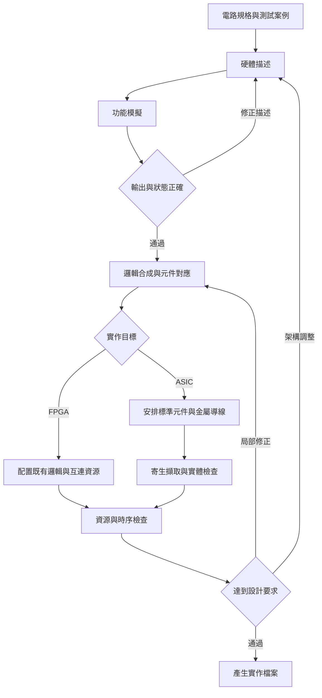
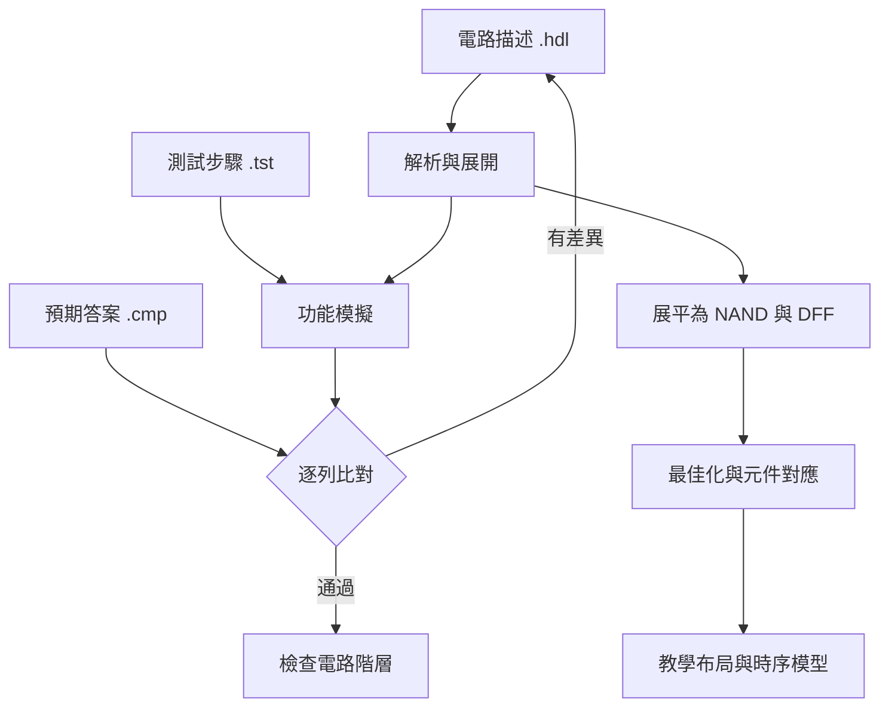
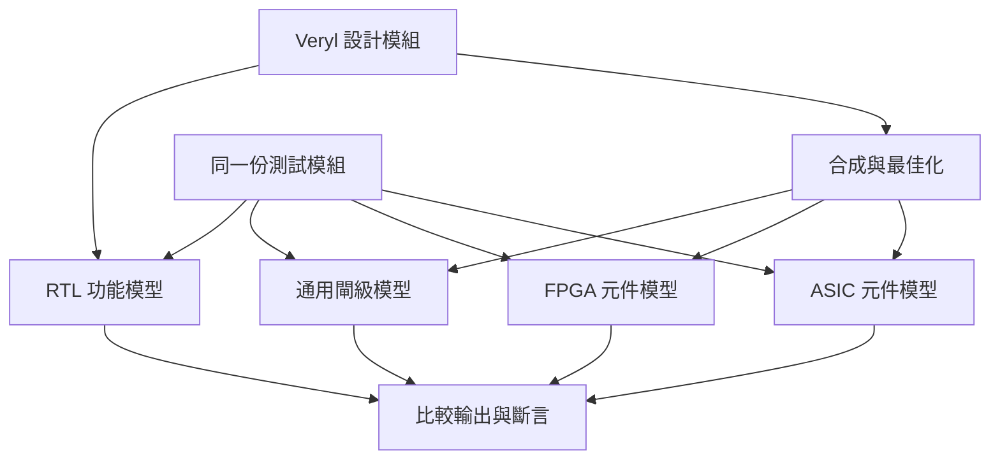
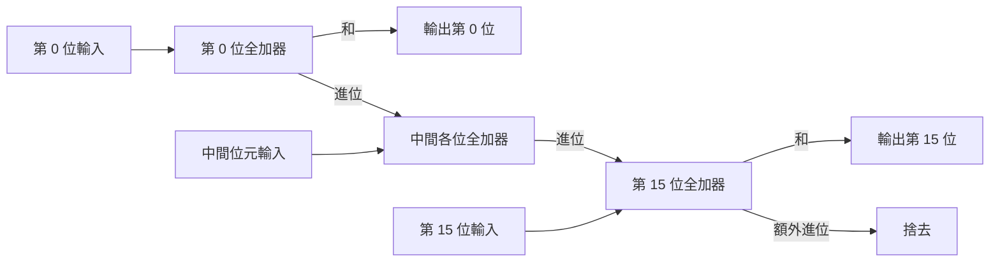
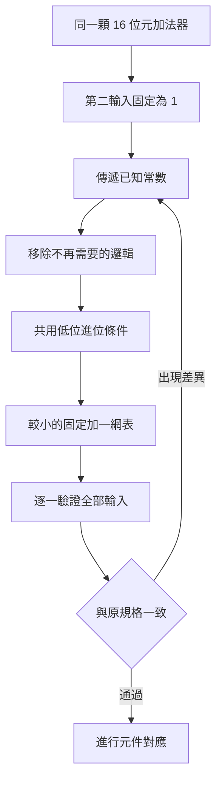
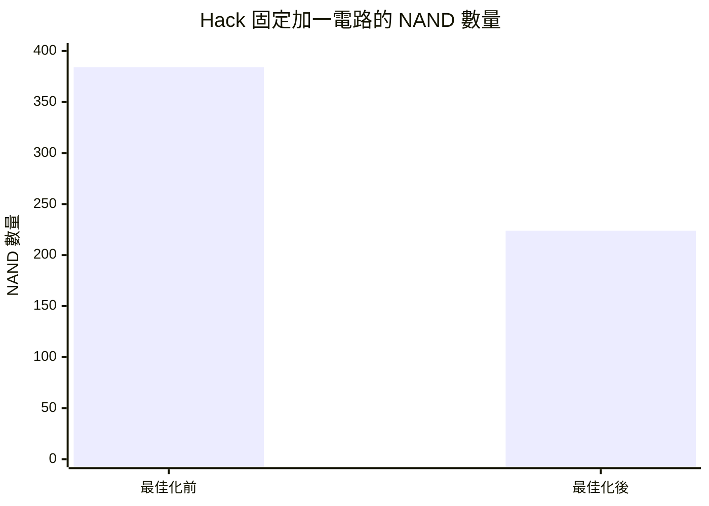
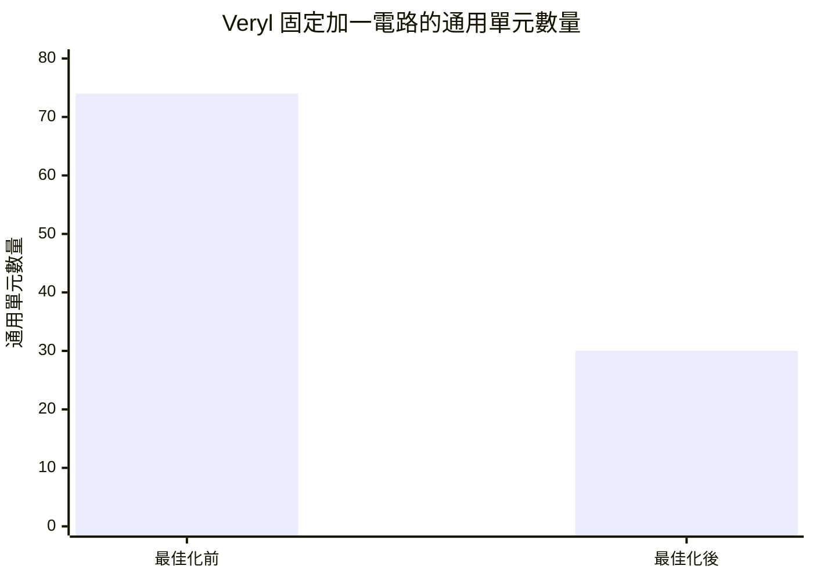
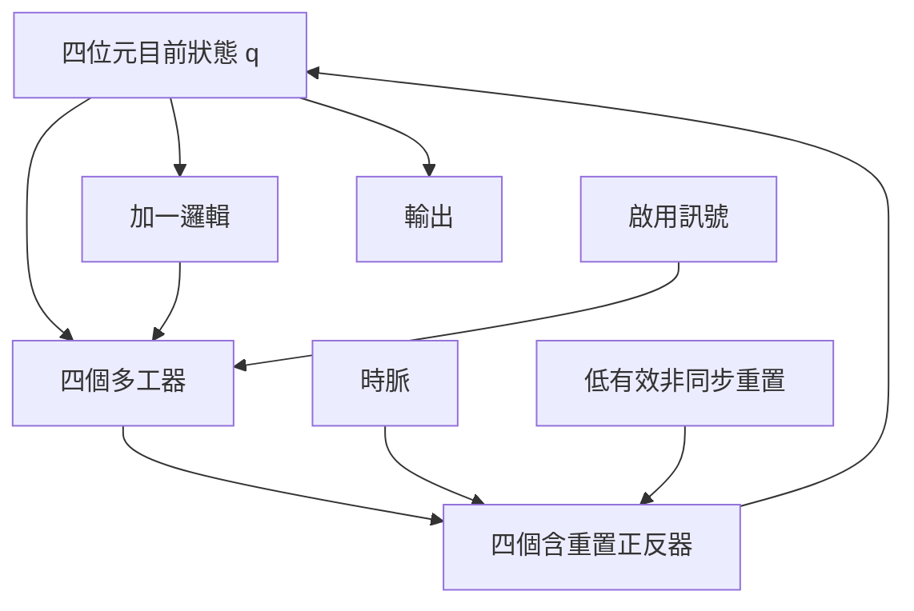
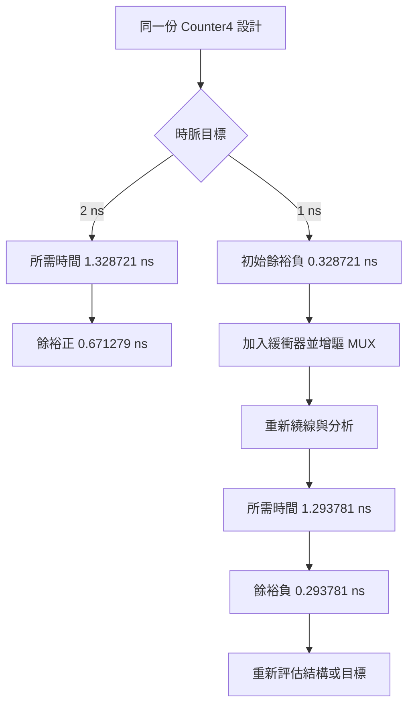

# IC 設計的 EDA 與實驗

**姓名：** 洪晨祐

**學號：** 111410517

使用gpt-6-astra製作

**聊天連結：** https://chatgpt.com/share/6ae4a2b5-8914-83ec-8eee-4c45d640bc7f

| 報告資訊 | 內容 |
|---|---|
| 研究主題 | 數位 IC 的電子設計自動化、功能驗證、邏輯合成與實體設計 |
| 實驗工具 | veryl2chip、Nand2tetris 網頁專案 `ccc-js/hack-computer` |
| 核心案例 | 16 位元加法器、固定加一電路、4 位元可啟用計數器 |
| 延伸實驗 | FPGA 接腳限制、2 ns／1 ns 時序約束與自動修正 |
| 主要資料 | 兩套工具原始碼、EDA 電子書、康乃爾大學 ECE 5745 課程 |
| 隨附資料 | `IC_EDA_Experiment_Package.zip`：設計、測資、執行腳本、指定版本核心與原始輸出 |

## 摘要

本報告以兩套可在網頁使用的開源工具，研究數位積體電路從硬體描述、功能模擬、邏輯合成到布局繞線的設計流程。實驗採用相同規格的 16 位元加法器與固定加一電路，比較 Nand2tetris 的元件接線描述，以及 Veryl 的運算與暫存器描述，再以 4 位元計數器分析狀態更新、重置、標準元件、寄生參數與時序收斂。

實驗使用兩套工具的網頁介面與固定版本核心。加法器的八組共同測資在兩套工具中均得到相同輸出；固定加一電路進一步對全部 65,536 種輸入進行窮舉，原始功能模型與受測的映射後網表全部通過。常數傳播使 `hack-computer` 的固定加一電路由 384 個 NAND 閘減少為 224 個；veryl2chip 的通用網表則由 74 個單元減少為 30 個。

實體設計部分出現兩項具體結果。第一，16 位元加法器雖通過 veryl2chip 的功能與映射測試，外露的 48 個輸入輸出訊號仍超出指定 FPGA 模型的 39 個可用接腳；改成 8 位元後成功完成布局繞線並產生位元流。第二，計數器在 2 ns 週期要求下通過時序分析，改成 1 ns 後，工具插入緩衝器並增強元件驅動能力，面積由 187.68 μm² 增加為 191.4336 μm²，最終仍有 0.293781 ns 的負時序餘裕。接腳數與時序要求會直接影響電路能否完成實作。

**關鍵詞：**電子設計自動化、硬體描述語言、邏輯合成、布局繞線、靜態時序分析、常數傳播、FPGA、ASIC。

---

## 目錄

- [1. 研究目的與問題](#1-研究目的與問題)
- [2. IC 設計的 EDA 是什麼](#2-ic-設計的-eda-是什麼)
- [3. 實驗環境與研究方法](#3-實驗環境與研究方法)
- [4. 兩套工具的實際操作流程](#4-兩套工具的實際操作流程)
- [5. 實驗一：16 位元加法器](#5-實驗一16-位元加法器)
- [6. 實驗二：固定加一與常數最佳化](#6-實驗二固定加一與常數最佳化)
- [7. 實驗三：計數器、狀態與重置](#7-實驗三計數器狀態與重置)
- [8. 實驗四：寄生參數與時序收斂](#8-實驗四寄生參數與時序收斂)
- [9. 實驗五：FPGA 接腳限制與縮寬驗證](#9-實驗五fpga-接腳限制與縮寬驗證)
- [10. 功能差異與比較分析](#10-功能差異與比較分析)
- [11. 實驗心得、結論與延伸方向](#11-實驗心得結論與延伸方向)
- [附錄 A：完整設計與測資](#附錄-a完整設計與測資)
- [附錄 B：版本、重現方式與結果檔案](#附錄-b版本重現方式與結果檔案)
- [附錄 C：代表性原始輸出](#附錄-c代表性原始輸出)
- [參考文獻](#參考文獻)

---

## 1. 研究目的與問題

在程式設計中，原始碼經過編譯後成為可執行程式；在數位 IC 設計中，硬體描述也會經過解析、轉換與最佳化，最後形成由邏輯元件與導線組成的電路。兩者都有「把較高層描述轉換成較低層實作」的過程，而 IC 設計還必須處理元件大小、接腳、位置、導線、時脈與供電等條件。

實驗分成三個層次：

1. **功能層次：**相同的加法器，在兩套語言中如何描述與測試？
2. **結構層次：**同樣的運算經過最佳化與元件對應後，會變成哪些邏輯閘、查找表或標準元件？
3. **實體層次：**當電路功能正確，接腳、導線與時間限制又如何影響實作？

四份指定資料各有不同角色，彼此可以形成完整的學習路徑。

| 參考資料 | 本報告採用的內容 | 對應問題 |
|---|---|---|
| veryl2chip 專案 [〔1〕][1] | Veryl 模擬、通用網表、FPGA／ASIC 後端與可執行核心 | 一段硬體描述如何一路轉成實體設計？ |
| `hack-computer` 專案 [〔2〕][2] | Hack HDL、元件階層、測試腳本與迷你 EDA | 小電路如何組成加法器、暫存器與電腦？ |
| EDA 電子書 [〔3〕][3] | 控制流轉資料流、網表、計數器、實體設計演算法 | 工具內部為何需要這些表示與轉換？ |
| 康乃爾 ECE 5745 [〔4〕][4] | 標準元件庫、前後端流程、時序與驗證 | 教學實驗如何對照完整的數位 ASIC 方法？ |

Nand2tetris 從布林邏輯逐步建立算術電路、記憶體與計算機。實驗使用的 `hack-computer` 另提供 FPGA／ASIC 教學流程。[〔2〕][2] [〔5〕][5] [〔6〕][6]

## 2. IC 設計的 EDA 是什麼

### 2.1 用一個具體需求理解 EDA

EDA 是「電子設計自動化」（Electronic Design Automation）的縮寫。以本報告的計數器為例，設計者先提出需求：

> 儲存一個 4 位元數值，啟用時每個有效時脈加一，停用時保持，重置時清零。

EDA 工具接著協助回答：需要幾個暫存器？加一運算由哪些邏輯閘構成？哪些訊號要經過多工器？選用哪一種元件？元件放在哪裡？線路如何連接？下一個時脈到來之前，資料能否穩定？

這些問題分別屬於**功能驗證、邏輯合成、元件對應、實體設計與時序分析**。康乃爾課程把相應工作分成前端與後端流程，並在不同階段再次執行驗證，確認轉換後仍符合設計意圖。[〔7〕][7] [〔8〕][8]



*圖 1　EDA 的主要工作與回饋關係。流程中的檢查結果會決定下一步要修改哪個層次。*

### 2.2 硬體描述與一般程式的關係

硬體描述語言描述的是訊號、組合邏輯與狀態更新。暫存器傳輸層次（RTL）常用來表示暫存器之間的資料運算與更新規則。例如：

```veryl
assign o_s = i_a + i_b;
```

這行表示輸出由兩個輸入的加法結果決定，合成器會建立相應的組合電路。當輸入改變，結果經過電路傳播後改變；這顆加法器本身沒有內部暫存器。

相對地，以下片段描述暫存器在時脈事件發生時的更新規則：

```veryl
always_ff {
    if_reset {
        count = 0;
    } else if i_en {
        count += 1;
    }
}
```

`always_ff` 讓設計具備狀態，`i_en` 決定是否更新。在本報告的實際合成結果中，這段描述對應到 4 個具重置功能的正反器、4 個選擇新舊值的多工器，以及 6 個加一邏輯單元。後面的計數器實驗會逐項驗證這個對應。[〔9〕][9]

### 2.3 為什麼 EDA 的前半段很像編譯器？

| 編譯器中的工作 | EDA 中對應的工作 | 本報告的例子 |
|---|---|---|
| 語法解析、名稱與型別檢查 | 解析 HDL，檢查訊號寬度與模組連接 | `logic<16>` 與 `a[16]` 都需要正確位元寬度 |
| 展開與建立中間表示 | 展開模組階層，建立資料流或網表 | 將 `Add16` 展開到全加器、邏輯閘 |
| 常數摺疊、無用運算消除 | 常數傳播、邏輯化簡、移除無用節點 | 將加法器第二輸入固定為 1 |
| 選擇目標指令 | 選擇 FPGA 或 ASIC 的可用元件 | 對應 LUT、進位元件、XOR 或複合閘 |
| 依成本模型最佳化 | 依面積、延遲、功耗與約束最佳化 | 改用較強驅動的多工器、加入緩衝器 |

EDA 的成本還會受到位置影響。同一條邏輯連線，實際導線越長、負載越大，對延遲與功耗的影響就越大。因此，邏輯合成會先依可用資訊估計，布局繞線後再以更具體的資料更新分析。[〔7〕][7] [〔10〕][10]

EDA 電子書將條件敘述轉為資料選擇的過程，放在「控制流到資料流」中說明。對計數器而言，`i_en` 的兩種情況最後就形成「選擇加一結果或原值」的硬體關係；已知常數條件還能在轉換時直接化簡。[〔11〕][11]

### 2.4 FPGA 與 ASIC 兩條實作路徑

**FPGA，現場可程式化邏輯閘陣列：**晶片內已有邏輯與互連資源，工具決定如何配置這些資源。四輸入查找表（LUT4）可用 $2^4=16$ 個真值位元描述一個四輸入布林函數；實際器件另有正反器、進位鏈、記憶體與接腳等資源。veryl2chip 本次選用 iCE40UP5K-SG48，`hack-computer` 則使用專案的教學格點模型。[〔1〕][1] [〔12〕][12]

**ASIC，特殊應用積體電路：**工具從標準元件庫挑選邏輯元件，決定擺放位置與金屬走線，最後產生版圖。標準元件庫提供元件的邏輯、時間、負載與幾何資料；製程設計套件提供特定製程所需的規則與模型。[〔8〕][8] [〔10〕][10]

| 資料／格式 | 保存的主要資訊 | 在流程中的用途 |
|---|---|---|
| HDL、RTL | 訊號關係、運算與暫存器更新 | 描述並測試設計 |
| 網表 | 元件實例與接線 | 連接合成、模擬與實體設計 |
| Liberty，`.lib` | 邏輯功能、時序、負載及功耗模型 | 元件對應、時序與功耗分析 |
| LEF，`.lef` | 元件外框、接腳、金屬層與相關規則 | 布局與繞線 |
| SDC，`.sdc` | 時脈、輸入輸出延遲與路徑限制 | 定義時序目標 |
| DEF，`.def` | 某份設計的元件位置與走線配置 | 交換實體設計資料 |
| SPEF，`.spef` | 導線寄生電阻與電容 | 將擷取結果帶入分析 |
| SDF，`.sdf` | 元件與互連延遲 | 帶延遲的模擬反標註 |
| GDSII，`.gds` | 版圖幾何與階層 | 檢視與交換版圖 |
| FPGA 位元流，`.bin` 等 | 可程式化硬體的設定 | 配置相應 FPGA |

康乃爾後端教材實際連接了 `.lib`、`.lef`、`.sdc`、寄生資料與版圖輸出，這也提供了理解 veryl2chip 各階段產物的對照架構。[〔8〕][8] [〔10〕][10]

## 3. 實驗環境與研究方法

### 3.1 版本與實驗條件

| 項目 | 本次設定 |
|---|---|
| `hack-computer` 提交 | `b84f89006585c2ceab0ce1ce302e2efb20d57603` |
| veryl2chip 提交 | `e13fcf2430d384fe66fb490823c1460400064e9d` |
| veryl2chip 引擎版本 | `2.36.0` |
| EDA 電子書對照版本 | `26470c4211b18d0fda274b54a47b15e8d6691692` |
| 量化實驗環境 | Linux x64、Node.js `v24.22.1` |
| Hack 執行方式 | 原始 HDL 解析、階層展開、產生模擬器，以及原專案 FPGA／ASIC 核心 |
| Veryl 執行方式 | 專案提交的 `web/dist/api.cjs` 與 WebAssembly 核心 |
| Hack 布局隨機設定 | `xorshift32`，種子 5745，透過測試入口固定亂數來源 |
| Veryl 布局繞線種子 | 1 |
| Veryl FPGA 目標 | iCE40UP5K-SG48 |
| Veryl ASIC 目標 | 教學庫 `vlib`、SKY130 `sky130_fd_sc_hd` |
| SKY130 時序條件 | `tt_025C_1v80`：典型製程、25°C、1.8 V |

測試腳本載入指定版本的核心，輸入測資並保存結果；網頁介面使用相同的八組加法器測資比對輸出。

### 3.2 實驗安排

| 編號 | 電路／變因 | 觀察內容 | 驗證方法 |
|---|---|---|---|
| E1 | 16 位元加法器 `Add16` | 描述方式、輸出、通用網表與元件對應 | 八組共同測資、映射後模型 |
| E2 | 第二輸入固定為 1 的 `Inc16` | 常數傳播、元件數、映射深度 | 八組代表案例與 65,536 種輸入窮舉 |
| E3 | 4 位元可啟用計數器 | 狀態、保持、回繞與重置 | Hack 23 個完整週期；Veryl 7 個檢查點 |
| E4 | 計數器週期 2 ns 改為 1 ns | 時序餘裕、緩衝器、驅動能力、面積 | 相同設計、製程庫與種子，改變約束 |
| E5 | FPGA 加法器由 16 位元改為 8 位元 | 接腳容量、布局繞線與位元流 | 比較 48 個與 24 個資料 I/O |

表格分別標示工具測試結果、教材紀錄與公式推導。

### 3.3 如何比較「相同電路」

本報告先固定可觀察功能：

$$
\operatorname{Add16}(a,b)=(a+b)\bmod 2^{16}
$$

$$
\operatorname{Inc16}(x)=(x+1)\bmod 2^{16}
$$

兩邊都採 16 位元輸入與輸出，並以相同位元模式比較。內部結構則保留各工具的原有描述與轉換方式，才能觀察不同起點如何影響最佳化。

元件數依表示層級分欄：NAND／DFF 展平數、通用邏輯單元數、映射後元件數、打包後 FPGA 邏輯單元數、GDS 實例數。每個欄位回答不同問題。例如，一顆 LUT 能吸收數個布林運算，一個 FPGA 邏輯單元也可能同時容納 LUT 與正反器。

時間同樣分成三類：

| 時間種類 | 意義 | 本報告如何使用 |
|---|---|---|
| 測試的時脈步數／模擬時間 | 測試事件的順序與狀態更新 | 檢查計數、保持與重置 |
| 元件模型回報的 ns | 電路路徑延遲、建立與保持要求 | 討論實體時序 |
| 主機執行秒數 | 電腦執行模擬或合成所花時間 | 保留在紀錄，供重現時參考 |

`Add16` 與 `Inc16` 都是組合電路，主要呈現路徑延遲。計數器具有明確時脈，因此可進一步討論週期要求與時序餘裕。

## 4. 兩套工具的實際操作流程

### 4.1 Nand2tetris 網頁專案

操作入口：[Hack HDL 模擬器](https://ccc-js.github.io/hack-computer/dist/hdl.html)。

1. 選擇「內建章節晶片」，章節選「02 加法器/ALU」，案例選 `Add16`。
2. 觀察 `.hdl`、`.tst`、`.cmp` 三個欄位：分別是電路、測試步驟與預期答案。
3. 按「執行」，原始六組內建測試產生輸出表，並顯示通過。
4. 改為「自訂貼上」，貼入附錄 A 的同一份 `Add16` 與八組共同測資、預期答案，再執行一次。
5. 按「檢視電路圖」，可逐層觀察 `Add16`、`FullAdder` 與更小的邏輯元件。
6. 按「合成 LUT」，依序查看展平、技術無關最佳化、元件對應、布局、繞線與時序；在浮層中切換 FPGA／ASIC。

本次八組自訂測試實際顯示「✓ 通過」，合成報告也顯示 `384 → 376`、`76 LUT4`，與固定版本核心輸出相符。現行介面的內建案例模式會採用編輯後、保留原 `CHIP` 名稱的 HDL，測資則沿用內建版本；自行修改 `.tst` 與 `.cmp` 時採「自訂貼上」。[〔13〕][13]



*圖 2　Hack HDL 的測試檔案與合成流程。測試案例、電路描述及預期答案各自獨立。*

### 4.2 veryl2chip 網頁環境

操作入口：[veryl2chip IDE](https://ccc-eda.github.io/veryl2chip/web/dist/index.html)。

1. 打開左側「範例庫」，選擇「Adder 加法器」。內建範例為 8 位元。
2. 在編輯器貼入附錄 A 的 16 位元版本，設計與測試模組放在同一份 `.veryl` 檔案。
3. 按「▶ 測試」，在「輸出」面板查看八組資料與 `TestAdd16: PASS`，在「波形」面板觀察訊號。
4. 按「進階」，顯示模擬對象、合成頂層、目標與階段選單。合成頂層選 `Add16`，測試頂層則由 `#[test]` 指定。
5. 使用「全面驗證」或切換閘級模型，讓相同測試套用到不同網表。
6. 目標選 FPGA、ASIC · vlib 或 ASIC · SKY130，再查看對應、布局、繞線與時序結果。[〔1〕][1]

本次網頁輸出與核心測試中的八組值一致。量化部分另透過官方 WebAssembly API 固定版本、目標與亂數種子，保存每一階段的原始回應，包含網表、波形、版圖與錯誤訊息。



*圖 3　同一份測試在不同表示層次重複執行。這能把描述、最佳化與元件對應的結果相互對照。*

### 4.3 兩種操作方式帶來的觀察差異

Hack HDL 很適合從「哪個元件接到哪裡」開始理解。當加法結果錯誤，可以追查全加器的和位元、進位以及子元件的連線。Veryl 則能用較精簡的運算與狀態描述表示設計，再藉合成結果理解這些敘述被轉成哪些硬體。

兩種方式都能描述相同功能，差別在於設計者一開始指定多少結構，以及工具接手多少轉換工作。後面的實驗將使用相同輸入，連接這兩種觀察角度。

## 5. 實驗一：16 位元加法器

### 5.1 電路規格與設計方式

加法器有兩個 16 位元輸入與一個 16 位元輸出，最高位產生的額外進位捨去。以二進位數學表示，輸出就是 $(a+b)\bmod 65536$。

Hack HDL 的 `Add16` 使用 16 個全加器，前一位的進位接到下一位的進位輸入。以下節錄起點與終點，完整版本放在附錄 A。[〔14〕][14]

```hdl
FullAdder(a=a[0], b=b[0], c=false, sum=out[0], carry=c0);
FullAdder(a=a[1], b=b[1], c=c0, sum=out[1], carry=c1);
// 第 2～14 位以同樣方式連接
FullAdder(a=a[15], b=b[15], c=c14, sum=out[15], carry=c15);
```

每個全加器對應三個輸入位元 $a_i,b_i,c_i$，產生和位元 $s_i$ 與下一位進位 $c_{i+1}$：

$$
s_i=a_i\oplus b_i\oplus c_i
$$

$$
c_{i+1}=(a_i\land b_i)\lor(a_i\land c_i)\lor(b_i\land c_i)
$$

專案的 `FullAdder.hdl` 直接使用 XOR、AND、OR 實作上述關係，接線本身就呈現了全加器的組成。[〔15〕][15]

Veryl 的同功能版本則寫成：

```veryl
module Add16 (
    i_a: input logic<16>,
    i_b: input logic<16>,
    o_s: output logic<16>,
) {
    assign o_s = i_a + i_b;
}
```

這段由專案的 8 位元範例改寫，位寬擴充為 16，讓合成器建立加法結構。[〔16〕][16]



*圖 4　逐位傳遞進位的加法器。最長資料依賴可能沿進位方向穿過多個位元。*

### 5.2 測試方法

Hack 測試腳本使用 `set` 設定輸入，`eval` 求值，`output` 記錄結果，再與 `.cmp` 比較。Veryl 測試模組則設定變數、推進測試時間，使用 `$assert` 檢查輸出。

Veryl 測試中的 `$tb::clock_gen` 僅用來安排每組輸入的觀察時刻；`Add16` 的埠與電路中都沒有時脈。這樣可以在波形上分開八組測資，同時保留組合加法器的設計規格。

### 5.3 共同測資結果

表中數字採無符號十進位。

| 編號 | 輸入 $a$ | 輸入 $b$ | 預期輸出 | Hack／Veryl 觀察值 | 測試目的 |
|---:|---:|---:|---:|---|---|
| 1 | 0 | 0 | 0 | 0／0 | 零輸入 |
| 2 | 10 | 20 | 30 | 30／30 | 一般加法 |
| 3 | 255 | 1 | 256 | 256／256 | 低 8 位連續進位 |
| 4 | 32767 | 1 | 32768 | 32768／32768 | 進位進入最高位 |
| 5 | 65535 | 1 | 0 | 0／0 | 16 位元回繞 |
| 6 | 65535 | 65535 | 65534 | 65534／65534 | 全一相加並捨去最高進位 |
| 7 | 43690 | 21845 | 65535 | 65535／65535 | `0xAAAA + 0x5555` |
| 8 | 4660 | 39030 | 43690 | 43690／43690 | 一般混合位元模式 |

八組測資全部一致。第 5 組很適合檢查位寬：`65535 + 1` 的數學結果為 65536，16 位元輸出保留低 16 位後得到 0。第 4 組的 `0x8000` 若以二補數解讀會顯示為負數，位元模式仍是同一個結果；因此測資檔以二進位輸出保存比較基準。

映射後也使用相同輸入再次驗證：

| 工具 | 受測表示層次 | 結果 |
|---|---|---|
| Hack | HDL 功能模型、FPGA LUT 網表、ASIC 元件網表 | 各 8／8 通過 |
| Veryl | RTL、最佳化通用網表、iCE40、vlib、SKY130 | 各 8／8 通過 |

這組測試覆蓋了零值、進位、回繞與混合位元。`Add16` 的完整輸入空間有 $2^{32}$ 種，本實驗以這八組有目的的案例檢查主要邊界，完整窮舉則留給下一節輸入較少的 `Inc16`。

### 5.4 合成結果：同功能如何變成不同表示

| 階段 | Hack `Add16` | Veryl `Add16` |
|---|---|---|
| 描述方式 | 16 個全加器的接線 | 16 位元加法運算 |
| 展平／通用最佳化前 | 384 個 NAND | 74 個通用單元 |
| 最佳化後 | 376 個 NAND | 74 個通用單元 |
| FPGA 元件對應 | 76 個 LUT4，0 DFF | 17 個 LUT4＋14 個進位元件 |
| 教學 ASIC 對應 | 243 個元件 | vlib：74 個元件 |
| SKY130 對應 | 本專案 ASIC 使用教學庫 | 60 個標準元件 |

Veryl 的 74 個通用單元可分成 31 XOR、29 AND 與 14 OR。這裡的進位使用可共用中間值的等價寫法：

$$
p_i=a_i\oplus b_i,\qquad s_i=p_i\oplus c_i,
\qquad c_{i+1}=(a_i\land b_i)\lor(p_i\land c_i)
$$

和位元與進位共用 $p_i$，所以中間每位使用 2 XOR、2 AND、1 OR。最低位的進位輸入已知為 0，可用 XOR 與 AND；最高位只需要產生和，不必保留輸出範圍以外的進位。因此：

$$
2+14\times5+2=74
$$

這說明工具回報的「最佳化前」已經是建立完成的通用網表，建立過程本身可以運用位寬與已知條件。後續通用最佳化得到 `74 → 74`，表示這個階段在該表示上沒有再減少單元。

SKY130 對應結果為 31 個 XOR、15 個 AND、14 個 `a21o` 複合閘，共 60 個。`a21o` 可以合併部分 AND／OR 關係，讓兩個通用單元的功能由一個標準元件完成。這正是「技術對應」依元件庫選擇實作的具體例子。[〔19〕][19]

<details>
<summary>展開：為什麼 376 個 NAND 與 74 個通用單元不能直接當成面積比？</summary>

兩者使用的基本單位不同。NAND 展平把 XOR、OR、MUX 等結構繼續拆成 NAND；通用網表則允許 XOR 等較大功能各占一個單元。同時，兩份加法器的進位公式與最佳化方法也不同。

真正評估面積時，需要在指定元件庫下加總各個元件的實體面積：

$$
A_{cells}=\sum_{j=1}^{N} A(\text{cell}_j)
$$

同樣數量的 XOR 與反相器，面積通常不同；兩個不同教學庫對同名元件設定的面積也可能不同。因此，本報告先比較邏輯結構，再於同一元件庫內比較面積。

</details>

### 5.5 ASIC 產物與 FPGA 進度

在 veryl2chip 的 SKY130 流程中，`Add16` 完成布局與詳細繞線，回報標準元件總面積 **470.4512 μm²**、詳細繞線長度 **1338.14 μm**、最長路徑 **3.225232 ns**，並輸出 **190,386 位元組**的 GDS。工具內建的短路、間距、面積與開路檢查，回報值皆為 0。

FPGA 流程則在接腳容量檢查時停止，原因與邏輯對應不同：31 個映射元件的功能已通過測試，設計對外卻要求 48 個 I/O。這個結果於第 9 節以縮小位寬的控制實驗繼續分析。

## 6. 實驗二：固定加一與常數最佳化

### 6.1 實驗設計

第二個實驗沿用加法器，把第二輸入固定為 1，得到：

$$
y=(x+1)\bmod 2^{16}
$$

Hack 的 `Inc16` 透過 `Add16` 接上常數；Veryl 實驗也刻意實例化同一顆 `Add16`，以便觀察常數如何穿過模組邊界，影響後面的網表。

```veryl
module Inc16 (
    i_x: input logic<16>,
    o_y: output logic<16>,
) {
    inst adder: Add16 (
        i_a: i_x,
        i_b: 16'd1,
        o_s: o_y,
    );
}
```

在 Hack 網頁中，可直接選「02 加法器/ALU → Inc16」，先執行測試，再打開「合成 LUT」的最佳化階段；在 Veryl 網頁中，使用附錄的 `Inc16` 設計，並將合成頂層選為 `Inc16`。

### 6.2 為什麼固定加一可以簡化？

一般加法器要處理兩組任意輸入；固定加一時，每一位的變化只取決於輸入本身與低位是否全為 1：

$$
y_0=\neg x_0
$$

$$
y_i=x_i\oplus\left(\bigwedge_{k=0}^{i-1}x_k\right),\qquad 1\le i\le15
$$

例如，`0111 + 1 = 1000`，第 3 位翻轉是因為低三位全為 1；`0101 + 1 = 0110`，進位到第 2 位以前就停止了。

若共用逐步累積的進位，只需要 1 個反相器、15 個 XOR 與 14 個 AND：

$$
1+15+14=30
$$

本次 veryl2chip 最佳化後正好得到這個組成。



*圖 5　常數傳播與功能驗證配合的實驗流程。*

### 6.3 最佳化前後的量化結果

兩列分別使用各工具的表示單位。

| 工具與表示 | 最佳化前 | 最佳化後 | 減少數量 | 減幅 |
|---|---:|---:|---:|---:|
| Hack，NAND 閘 | 384 | 224 | 160 | 41.67% |
| Veryl，通用邏輯單元 | 74 | 30 | 44 | 59.46% |

減幅計算為：

$$
r=\frac{N_{before}-N_{after}}{N_{before}}\times100\%
$$

Hack 的 `384 → 224` 與專案 README 所舉範例相符，這次透過指定版本核心與原始輸出重新確認了該數字。[〔2〕][2]





*圖 6、圖 7　兩個圖分別使用 NAND 與通用單元，呈現各工具內部的最佳化效果。*

### 6.4 全輸入窮舉驗證

`Inc16` 只有一個 16 位元輸入，所有二值輸入共有：

$$
2^{16}=65,536
$$

因此本次測試把輸入從 0 依序設定到 65535，比較觀察值與 `(x + 1) & 0xFFFF`。Veryl 的預期值使用較寬整數運算後再取低 16 位，將測試判定與待測電路的輸出位寬分開。

| 工具 | 驗證對象 | 測試數 | 通過 | 失敗 |
|---|---|---:|---:|---:|
| Hack | 官方 HDL 產生的功能模擬器 | 65,536 | 65,536 | 0 |
| Hack | FPGA LUT 真值表網表 | 65,536 | 65,536 | 0 |
| Hack | ASIC 元件網表 | 65,536 | 65,536 | 0 |
| Veryl | RTL 模型 | 65,536 | 65,536 | 0 |
| Veryl | 最佳化通用網表 | 65,536 | 65,536 | 0 |
| Veryl | iCE40 元件網表 | 65,536 | 65,536 | 0 |
| Veryl | vlib 元件網表 | 65,536 | 65,536 | 0 |
| Veryl | SKY130 元件網表 | 65,536 | 65,536 | 0 |

這個結果完整覆蓋了此 16 位元二值組合函數的輸入空間，也驗證了本次受測映射的輸出。它與第 5 節八組案例的差別，在於這裡的有限輸入空間可以全部列舉。

### 6.5 同一套模型內，面積與延遲如何改變？

先比較 veryl2chip 中的同一個 SKY130 元件庫：

| 指標 | `Add16` | `Inc16` | 觀察 |
|---|---:|---:|---|
| 標準元件數 | 60 | 30 | 減少 50% |
| 元件面積，μm² | 470.4512 | 222.7136 | 減少 52.66% |
| 詳細繞線長度，μm | 1338.14 | 739.68 | 需要連接的網路減少 |
| 最長路徑，ns | 3.225232 | 2.687766 | 縮短 16.66% |
| GDS 大小，位元組 | 190386 | 111690 | 版圖幾何資料也隨之改變 |

元件數減半，路徑延遲則縮短約六分之一。面積取決於所有元件的總和，延遲取決於最慢那條路徑，兩者對同一個修改的反應自然不同。

Hack 的教學 FPGA 模型呈現另一個值得研究的結果：

| 指標 | `Add16` | `Inc16` |
|---|---:|---:|
| 最佳化 NAND 數 | 376 | 224 |
| LUT4 數 | 76 | 60 |
| 回報的最長路徑，ns | 24.65 | 43.50 |
| 關鍵路徑列表的節點數，含主輸入 | 18 | 31 |

雖然 `Inc16` 使用較少 NAND 與 LUT，這次映射後的依賴路徑更長，模型回報的延遲也增加。從路徑列表可觀察到，`Inc16` 反覆經過中間 AND 關係與進位節點。化簡後的邏輯圖、LUT 切割方式與路徑深度，都會影響延遲。

進一步檢查原始碼後，確認這兩個案例的 FPGA 延遲計算使用了固定距離預設值，所以數值主要反映映射深度：$17\times(1.2+0.25)=24.65$ ns，$30\times(1.2+0.25)=43.50$ ns。第 10.3 節保留了這項程式層級的觀察，供解讀教學模型時參考。[〔34〕][34]

因此，最佳化不能只看「總共少了幾個元件」。設計者還需要查看那些元件是否位於關鍵路徑，以及技術對應有沒有善用目標硬體的資源。本次 veryl2chip 的一般 `Add16` 使用了 iCE40 專用進位元件；其 `Inc16` 則映射成 20 個 LUT4，也顯示兩種功能在映射後可能走不同結構。

<details>
<summary>展開：本實驗如何執行映射後驗證？</summary>

Hack 的 FPGA 網表依 LUT 的輸入位元組成索引，再從真值表取出輸出，求值方式對照上游測試中的 `evalLuts`；ASIC 網表使用原專案匯出的 `evalCells`。兩者使用實際合成產生的網表，逐一測試 65,536 組輸入。[〔12〕][12] [〔17〕][17]

Veryl 透過同一個官方模擬入口，依序選擇 RTL、`opt`、`ice40`、`asic` 與 `sky130`。本次 API 以 `synth: 'Inc16'` 指定合成頂層，搭配 `gate` 選擇網表種類，讓工具把待測模組替換成相應網表，測試模組的輸入與斷言保持一致。完整請求與回應存放於實驗附件。

</details>

## 7. 實驗三：計數器、狀態與重置

### 7.1 從組合電路加入記憶能力

前兩個實驗的輸出只由當前輸入決定。計數器加入暫存器，輸出還取決於先前狀態。令目前計數值為 $q$，下一個狀態為 $q^+$，在重置未作用時：

$$
q^+=
\begin{cases}
(q+1)\bmod16, & en=1,\\
q, & en=0.
\end{cases}
$$

Veryl 版本延續 EDA 電子書的計數器概念，採用上升緣更新、低有效非同步重置。Hack 版本則以 DFF、加一邏輯與多工器接線，採用高有效同步重置。這兩個版本用來比較狀態描述與重置實作，重置規格分別列明。[〔6〕][6] [〔9〕][9] [〔23〕][23]

| 項目 | Hack `Counter4` | Veryl `Counter4` |
|---|---|---|
| 狀態寬度 | 4 位元 | 4 位元 |
| 啟用 | `enable=1` 時加一 | `i_en=1` 時加一 |
| 保持 | `enable=0` 時保持 | `i_en=0` 時保持 |
| 回繞 | 15 的下一值為 0 | 15 的下一值為 0 |
| 重置有效電位 | 高有效 | 低有效 |
| 重置更新時刻 | 隨 DFF 的同步更新 | 重置作用時即可清零 |
| 測試步進 | `tick`／`tock` | 時脈事件與 `clk.next(...)` |

### 7.2 Veryl 描述與 14 個通用單元

核心描述如下：

```veryl
module Counter4 (
    i_clk: input clock,
    i_rst: input reset,
    i_en: input logic,
    o_q: output logic<4>,
) {
    var q: logic<4>;
    always_ff {
        if_reset {
            q = 4'd0;
        } else if i_en {
            q = q + 4'd1;
        }
    }
    assign o_q = q;
}
```

本次通用合成得到 14 個單元，與教材計數器相同：

| 元件 | 數量 | 在計數器中的作用 |
|---|---:|---|
| 含非同步重置的 DFF，正反器 | 4 | 儲存四個狀態位元 |
| MUX，多工器 | 4 | 各位選擇加一結果或原值 |
| XOR，互斥或閘 | 3 | 高三位與進位組合 |
| AND，且閘 | 2 | 建立並共用進位條件 |
| NOT，反相器 | 1 | 最低位翻轉 |
| **合計** | **14** | 狀態、選擇與加一邏輯 |



*圖 8　計數器的資料回饋。停用時，多工器選擇原狀態；啟用時選擇加一結果。*

<details>
<summary>展開：從布林式推導 6 個加一邏輯單元</summary>

將狀態寫成 $q_3q_2q_1q_0$，加一結果寫成 $s_3s_2s_1s_0$：

$$
s_0=\neg q_0,\qquad s_1=q_1\oplus q_0
$$

$$
c_2=q_1\land q_0,\qquad s_2=q_2\oplus c_2
$$

$$
c_3=q_2\land c_2,\qquad s_3=q_3\oplus c_3
$$

共計 1 NOT、3 XOR、2 AND。再令每個正反器的資料輸入為：

$$
D_i=\begin{cases}s_i,&en=1\\q_i,&en=0\end{cases}
$$

就得到 4 個 MUX，接到 4 個正反器。因此總數是 $6+4+4=14$。重置功能由所選正反器提供。教材生成的 Verilog 具有 `posedge` 時脈與 `negedge` 重置敏感事件，並以低電位清零，可直接核對其重置極性與非同步性。[〔23〕][23]

</details>

### 7.3 Veryl 計數器的實測結果

以下七個檢查點在 RTL、通用閘、iCE40、vlib 與 SKY130 五種模型中均通過：

| 檢查點 | 測試動作 | 預期值 | 觀察值 |
|---:|---|---:|---:|
| 1 | 重置有效，推進一個測試時脈 | 0 | 0 |
| 2 | 解除重置，啟用 3 拍 | 3 | 3 |
| 3 | 停用並再推進 2 拍 | 3 | 3 |
| 4 | 再啟用 14 拍，$3+14\equiv1\pmod{16}$ | 1 | 1 |
| 5 | 讓重置變為有效，未再推進時脈 | 0 | 0 |
| 6 | 維持重置 2 拍 | 0 | 0 |
| 7 | 解除重置並啟用 1 拍 | 1 | 1 |

第 3 點驗證保持能力，第 4 點驗證位寬回繞，第 5 點則直接觀察非同步重置：測試沒有呼叫下一次時脈步進，輸出就已清為 0。

### 7.4 Hack 計數器的接線與抽象時脈

Hack 版本先接出相同的四位元加一邏輯，再加入啟用與同步重置選擇。例如最低位：

```hdl
Not(in=q0, out=i0);
Mux(a=q0, b=i0, sel=enable, out=e0);
Mux(a=e0, b=false, sel=reset, out=d0);
DFF(in=d0, out=q0, out=out[0]);
```

第二個 MUX 在重置時把 DFF 的資料輸入選為 0，並由同步更新提交。由於重置選擇接在啟用選擇之後，兩者同時作用時，重置具有優先權。

本次連續測試 23 個完整的 `tick`／`tock` 週期，23 個狀態結果均通過。部分紀錄如下：

| 週期 | 啟用 | 重置 | 更新前 | `tick` 後 | `tock` 後 |
|---:|---:|---:|---:|---:|---:|
| 1 | 1 | 1 | 0 | 0 | 0 |
| 2 | 1 | 0 | 0 | 0 | 1 |
| 3 | 1 | 0 | 1 | 1 | 2 |
| 4 | 0 | 0 | 2 | 2 | 2 |
| 5 | 1 | 0 | 2 | 2 | 3 |
| 6 | 1 | 1 | 3 | 3 | 0 |
| 7 | 0 | 0 | 0 | 0 | 0 |
| 22 | 1 | 0 | 14 | 14 | 15 |
| 23 | 1 | 0 | 15 | 15 | 0 |

在此模擬引擎中，`tick` 取樣、`tock` 提交狀態，因此表中可看到舊值與新值的界線。這是理解循序電路「所有狀態元件依同一輪舊狀態更新」的實用觀察方式。

其展平結果為 91 個基礎元件，最佳化後 79 個，兩者均包含 4 個 DFF；FPGA 映射得到 13 LUT4＋4 DFF，教學 ASIC 映射得到 66 個元件。本案例的功能測試涵蓋原始 HDL 與 `.tst/.cmp`，後續章節的定量時序收斂則使用 Veryl 的非同步重置版本。

### 7.5 版圖數字與教材紀錄對照

Veryl 計數器在 SKY130 中映射為 4 個重置正反器、4 個 MUX、3 個 XOR、2 個 AND、1 個反相器。以下將**本次實測**與 **EDA 電子書所附紀錄**並列。[〔22〕][22]

| 指標 | 本次實測 | 教材紀錄 |
|---|---:|---:|
| 功能元件數 | 14 | 14 |
| 元件總面積，μm² | 187.6800 | 187.7 |
| 版圖外框，μm | 17.94 × 19.04 | 17.9 × 19.0 |
| 利用率 | 54.945% | 55% |
| 關鍵路徑，ns | 1.328721 | 1.339 |
| 工具回報頻率，MHz | 752.604 | 747.0 |
| 最差保持餘裕，ns | 0.340962 | 0.343 |
| 詳細繞線總長，μm | 266.80 | 283 |
| GDS 實例數 | 56 | 62 |

本次外框面積為：

$$
A_{outline}=17.94\times19.04=341.5776\ \mu m^2
$$

$$
U=\frac{187.68}{341.5776}\approx54.945\%
$$

標準元件面積是元件面積總和，外框面積包含整個配置區域。版圖還需要走線空間、填充元件與井接點，因此 GDS 實例數會高於功能元件數。教材的 62 個實例由 14 個邏輯元件、37 個填充元件與 11 個井接點組成；這能具體解釋「14 個單元」與「62 個版圖實例」各自計數的內容。[〔22〕][22]

兩組結果的功能元件組成相同，布局與走線數值略有差異；比較時需一併考慮種子、工具版本與約束。

## 8. 實驗四：寄生參數與時序收斂

### 8.1 導線為什麼會影響結果到達的時間？

在邏輯圖上，一條線表達連接關係；在實體設計中，導線有長度、寬度、厚度與所在金屬層，會形成電阻與電容。當元件切換輸出時，必須透過有限的驅動能力，對連線與下一級輸入的電容充放電。

在固定材質與截面的簡化模型中：

$$
R=\rho\frac{L}{wt},\qquad C\approx cL
$$

其中 $L$ 是線長，$w$ 是線寬，$t$ 是厚度，$\rho$ 是電阻率，$c$ 是單位長度電容。導線變長，電阻與電容通常一起增加，未插緩衝器的均勻導線，其 RC 延遲項會呈現約與 $L^2$ 相關的成長。

veryl2chip 的寄生擷取程式依詳細走線切分線段，使用製程資料取得線段電阻、電容與接點電阻，再沿路徑加總「電阻乘上下游電容」，形成 Elmore 延遲近似。[〔20〕][20]

$$
t_{wire}\approx\sum_i R_iC_{downstream,i}
$$

這也解釋了布局與邏輯最佳化的關係：改變元件位置會改變導線；換成驅動較強的元件，也會改變前後級負載。康乃爾工具教材指出，合成階段與布局繞線後的關鍵路徑可能不同，因為後者取得了更具體的位置與連線資訊。[〔10〕][10]

### 8.2 靜態時序分析如何判定「來得及」？

靜態時序分析（STA）沿著時序圖傳播到達時間，檢查被約束的路徑。概念上，最晚到達時間可用下式逐節點計算：

$$
A(v)=\max_{u\in pred(v)}\bigl(A(u)+d(u,v)\bigr)
$$

其中 $A(u)$ 是前一節點的到達時間，$d(u,v)$ 是對應的元件或互連延遲。對單一時脈、先忽略時脈偏移與不確定性的暫存器路徑，建立時間條件為：

$$
T_{clk}\ge t_{cq,max}+t_{logic,max}+t_{wire,max}+t_{setup}
$$

它要求發送正反器輸出的新資料，經過邏輯與導線後，在下一個擷取時脈以前保留足夠的穩定時間。[〔21〕][21] [〔24〕][24]

保持時間則檢查最快路徑：

$$
t_{cq,min}+t_{logic,min}+t_{wire,min}\ge t_{hold}
$$

它要求新資料不能太早破壞這次擷取所需要的舊資料。延長時脈週期通常能放寬建立時間預算；保持問題則要檢查最短資料路徑與時脈分配。[〔24〕][24]

### 8.3 先讀懂本次計數器的關鍵路徑

本次 SKY130 計數器在 2 ns 目標下，關鍵路徑各項如下。數值取自工具逐段回報，表格保留六位小數。

| 路徑部分 | 延遲，ns | 意義 |
|---|---:|---|
| 發送正反器，時脈到 Q | 0.406231 | 暫存器輸出新狀態 |
| 第一個 AND | 0.186496 | 建立低位進位條件 |
| 第二個 AND | 0.176645 | 繼續傳遞進位 |
| XOR | 0.140435 | 計算高位加一結果 |
| MUX | 0.301978 | 選擇加一結果或原值 |
| 此路徑直接列出的導線延遲總和 | 0.000116 | 擷取後的互連延遲項 |
| 接收正反器建立時間 | 0.116821 | 下一級擷取前的穩定需求 |
| **所需時間總和，使用未捨入值計算** | **1.328721** | 用來檢查週期預算 |

這個小型計數器的直接導線延遲項很小，主要時間落在正反器與邏輯元件。元件延遲本身仍依輸入轉換速度與輸出負載查表，負載包含線路電容，因此寄生影響也會透過元件模型反映。[〔21〕][21]

這份結果讓分析更具體：要改善本次電路，應先觀察正反器、MUX 與進位邏輯的貢獻，再評估布局與負載調整。

### 8.4 將週期要求從 2 ns 收緊到 1 ns

實驗保持相同的 `Counter4`、SKY130 元件庫與種子，改變時序約束。核心 SDC 指令分別為：

```tcl
create_clock -name sys_clk -period 2 [get_ports i_clk]
```

```tcl
create_clock -name sys_clk -period 1 [get_ports i_clk]
```

在本次時脈偏移為 0 的計數器案例中，以週期預算減去資料路徑所需時間，得到建立時間餘裕：

$$
slack=T_{budget}-T_{path}
$$

其中 $T_{budget}$ 是目標週期，$T_{path}$ 是包含建立時間要求的路徑所需時間。餘裕為正表示尚有時間，為負表示超過預算。本工具的 `WNS` 欄位回報受檢端點的最差建立餘裕；`TNS` 是受檢端點中負建立餘裕的總和。

| 指標 | 2 ns 目標 | 1 ns 目標 |
|---|---:|---:|
| 目標頻率 | 500 MHz | 1000 MHz |
| 最終所需時間，ns | 1.328721 | 1.293781 |
| 最差餘裕 WNS，ns | +0.671279 | −0.293781 |
| 負餘裕總和 TNS，ns | 0 | −0.453248 |
| 時序違規端點 | 0 | 2 |
| 邏輯元件數 | 14 | 15 |
| 元件總面積，μm² | 187.6800 | 191.4336 |
| 詳細繞線長度，μm | 266.8 | 280.6 |
| 新增緩衝器 | 0 | 1 |
| 元件增驅 | 0 | 1 |
| 工具內建四類 DRC 回報 | 全為 0 | 全為 0 |

在 1 ns 情況下，工具把其中一個 `mux2_1` 換成 `mux2_2`，並加入一個 `buf_1`。時序修正前的最差餘裕為 −0.328721 ns，修正後改善為 −0.293781 ns；所需時間縮短約 **2.63%**，元件面積增加 **2.00%**。

這是一次完整的「提出更緊要求 → 找到違規 → 修改元件與接線 → 重新分析」實驗。最終仍存在 0.293781 ns 的時間缺口，工具輸出明確保留了這個結果。



*圖 9　由實測數字構成的時序修正流程。工具完成改善，並回報尚未滿足的要求。*

### 8.5 邏輯與實體設計如何互相迭代？

這次實驗顯示，迭代可以先發生在局部：改元件驅動能力、加緩衝器、調整位置與走線，再計算新的時序與面積。若瓶頸來自過深的組合邏輯，才進一步考慮改寫運算結構或增加管線暫存器。

對計數器這種有回饋依賴的電路，增加管線會改變狀態更新關係，必須重新設計介面與測試；不能把一般加法器的切段方式直接套用。可行的研究方向包括更短的進位結構、不同狀態編碼或合適的時脈目標。

時序收斂的目標，是在指定條件下讓所檢查路徑達標，同時滿足面積、功耗與實體規則。每次迭代都有可觀察的判定標準，達成條件後即可結束該輪設計。[〔10〕][10]

### 8.6 功能、幾何與時序三種結果如何一起讀？

同一個計數器在不同驗證階段，得到以下三類結果：

| 問題 | 本次對應證據 |
|---|---|
| 狀態轉移是否符合計數器規格？ | RTL 與合成映射階段的模型，7 個狀態檢查點通過 |
| 版圖是否違反工具檢查的幾何規則？ | 1 ns 與 2 ns 兩個案例的內建 DRC 四類回報皆為 0 |
| 最終實體路徑是否符合 1 ns 要求？ | WNS = −0.293781 ns，仍有 2 個違規端點 |

veryl2chip 的內建 DRC 檢查包括短路、間距、面積與開路；版圖連通性比對與天線效應處理則由其他模組負責。[〔26〕][26] [〔27〕][27]

## 9. 實驗五：FPGA 接腳限制與縮寬驗證

### 9.1 功能通過後遇到的資源限制

`Add16` 在 veryl2chip 中通過 RTL 與四種映射模型的八組測試，iCE40 元件對應也完成。指定 iCE40UP5K-SG48 進行布局繞線時，工具回報：

```text
Error: design does not fit: needs 48 IO pins (the package has 39)
```

訊息的意思是：**設計需要 48 個輸入輸出接腳，這個封裝模型可提供 39 個。**

本電路直接把所有資料位元接到晶片外部，因此需要：

$$
N_{IO}=16+16+16=48
$$

在 Hack 的教學 FPGA 格點模型中，這份設計可以繼續顯示配置與延遲；在 veryl2chip 的具名器件與封裝模型中，I/O 容量則成為明確的實作條件。兩個工具在這裡關注的模型範圍，直接反映於實驗結果。

### 9.2 將位寬改為 8 位元

為驗證失敗原因，補做 `Add8`，保持「兩個輸入相加、輸出保留相同位寬」的運算形式，將資料 I/O 降為：

$$
N_{IO}=8+8+8=24
$$

測試案例包含 `10 + 20 = 30` 與 `255 + 1 = 0`，RTL 與 iCE40 模型皆通過。接著使用相同 FPGA 目標完成布局繞線。

| 指標 | `Add16` | `Add8` |
|---|---:|---:|
| 資料 I/O | 48 | 24 |
| 通用最佳化後單元數 | 74 | 34 |
| iCE40 映射元件數 | 31 | 15 |
| 布局繞線結果 | 接腳容量不足 | 完成 |
| 打包後邏輯單元 LC | 未完成配置 | 12 |
| 程式化互連點 PIP | 未完成繞線 | 161 |
| 繞線迭代的溢位數 | 未進入此階段 | 4 → 0 |
| 最長路徑，ns | 未產生完成結果 | 21.579 |
| 位元流 | 未產生 | 104,090 位元組 |

這個控制實驗支持原本的診斷：在所選 FPGA 模型下，外露接腳數是 `Add16` 的限制之一；縮小位寬後，設計得以通過該限制並完成流程。

若要保留 16 位元運算，另一個設計方向是把加法器放在較大的模組內，由暫存器分批接收資料，或透過序列介面傳輸。這樣內部仍可進行 16 位元加法，外部介面則使用較少接腳。本報告實際執行的修正是 8 位元版本，序列介面屬後續可延伸的架構實驗。

## 10. 功能差異與比較分析

### 10.1 設計目的與功能範圍

Nand2tetris 的學習路線強調從基本邏輯建立整台電腦，`hack-computer` 同時提供 HDL 模擬，以及 Jack 語言、虛擬機、組合語言等軟體工具鏈。veryl2chip 則以 Veryl 硬體描述為入口，把模擬、合成、FPGA 與 ASIC 實作串成一個可觀察的流程。[〔1〕][1] [〔2〕][2]

| 比較面向 | `hack-computer` | veryl2chip |
|---|---|---|
| 主要教學焦點 | 元件如何組成電腦，以及軟硬體層次如何銜接 | 硬體描述如何經 EDA 轉成可實作的設計 |
| 描述方式 | Hack HDL，使用 `PARTS` 接線組合元件 | Veryl，運算、條件、暫存器、模組與型別 |
| 加法器操作 | 直接觀察全加器與進位接線 | 由 `+` 合成，再觀察生成的網表 |
| 測試方法 | `.tst` 操作腳本與 `.cmp` 預期輸出 | 測試模組、斷言、波形與閘級模型 |
| 核心執行方式 | JavaScript，Node 與瀏覽器共用 | Rust 核心，網頁使用 WebAssembly |
| 通用邏輯表示 | 展平到 NAND 與 DFF | AND、OR、XOR、MUX、DFF 等通用單元 |
| FPGA 目標 | LUT4／DFF 教學格點模型 | 具體 iCE40 器件、進位鏈、封裝與互連資料 |
| ASIC 元件資料 | 內建教學元件與固定成本參數 | vlib 教學庫，以及 SKY130 標準元件資料 |
| ASIC 實體流程 | 依邏輯深度排元件，估算連線與時序 | 行式布局、時脈樹、整體／詳細繞線、寄生擷取 |
| 物理檢查 | 主要呈現教學模型的配置與分析 | 內建設計規則檢查、元件層級版圖連通性比對等 |
| 本次實作產物 | 模擬表格、網表與配置／分析資料 | 模擬資料、映射 Verilog、DEF、GDS、成功案例的 FPGA 位元流 |
| 適合深入的方向 | 邏輯、計算機組織、編譯與虛擬機 | RTL、合成演算法、元件庫、時序與實體實作 |

兩者的重疊區在模擬、邏輯轉換與可視化。`hack-computer` 讓結構拆解容易追蹤；veryl2chip 則讓接腳與製程模型的條件直接進入設計決策。本次 `Add16` 的 FPGA 接腳問題，是這項差異的具體實例。

### 10.2 演算法與模型的差異

| 工作 | Hack 專案中的實作 | Veryl 專案中的實作 | 對實驗的意義 |
|---|---|---|---|
| 階層展開 | 依 `PARTS` 展開子元件 | 解析 Veryl 並建立運算、控制與狀態關係 | 起始網表已可能具有不同結構 |
| 通用最佳化 | 常數傳播與局部邏輯整理 | 常數傳播、運算與通用閘網表最佳化 | `Inc16` 在兩者中都明顯縮小 |
| ASIC 技術對應 | 以局部圖樣貪婪改寫 MUX、AOI 等 | 對邏輯樹進行動態規劃與元件圖樣覆蓋 | 元件庫與切割方法影響元件數 |
| FPGA 對應 | NAND 圖切成 LUT4 | LUT4 加上器件專用進位、正反器等資源 | `Add16` 的 76 LUT 與 17 LUT＋14 CARRY 對應不同資源 |
| ASIC 布局與延遲 | 行式排列、固定元件延遲與距離／負載項 | 依標準元件與製程資料布局繞線、查表與 RC 分析 | 後者能研究製程資料帶來的影響 |

Hack 的 ASIC 核心在 `run()` 中執行布局與時序分析，連線延遲依距離與固定係數估算；veryl2chip 的 SKY130 ASIC 流程則產生詳細走線，再以線段幾何與製程資料擷取寄生。這個差異比畫面上是否出現「繞線」階段，更能解釋兩者數據的物理意義。[〔17〕][17] [〔18〕][18] [〔19〕][19] [〔20〕][20]

康乃爾合成課件把技術無關最佳化與技術相關對應分開，實體設計課件則將線長、壅塞與延遲列為不同目標。本次實驗可直接對上這些層次：`74 → 30` 發生在常數最佳化；`74 → 60` 則來自 SKY130 元件對應；布局、寄生與時序又在後面提供新的成本資訊。[〔30〕][30] [〔31〕][31]

### 10.3 從原始碼確認報告數字代表什麼

工具的統計單位與延遲計算方式如下。

**Hack FPGA 的延遲預設值。**原始碼以元件識別碼建立位置表，時序查詢卻使用網路名稱取位置；在本次兩個案例中，該查詢使用距離 1 的預設值。因此，24.65 ns 與 43.50 ns 可由 17 級、30 級 LUT 乘上固定每級 1.45 ns 重現。這組數字很適合比較映射後的依賴深度；若要觀察布局位置與幾何線長對此模型回報值的影響，可讓位置索引與網路驅動元件對應一致，再重新測試。[〔34〕][34]

**Hack ASIC 的路徑追蹤。**兩個組合電路都有正的 `criticalPathNs` 數值，原始回應的 `criticalPath` 陣列則為空。報告因此採用回報的總時間，並把可逐段分析的案例放在具有完整路徑內容的 Veryl 計數器。

**Veryl 的元件與版圖實例。**`Add16` 的 SKY130 邏輯元件數為 60，GDS 實例數為 163，後者還包含物理輔助元件。Counter4 的 6 LUT＋4 正反器也能打包為 6 個 FPGA 邏輯單元。邏輯元件、版圖實例與 FPGA 邏輯單元需分開計數。

### 10.4 功耗、效能與面積如何一起評估？

常見的設計目標是功耗、效能與面積。最簡化的動態功耗關係可寫為：

$$
P_{dynamic}\approx\alpha C V^2 f
$$

其中 $\alpha$ 是每週期平均有效充電活動，$C$ 是切換負載電容，$V$ 是電壓，$f$ 是操作頻率。實際總功耗還包含漏電等部分。[〔10〕][10] [〔24〕][24]

本次 1 ns 計數器的修改增加面積，換來較短延遲，呈現了面積與速度的取捨。若繼續比較功耗，適合把兩份設計的頻率與輸入活動固定，再觀察增驅與緩衝器造成的電容與切換變化。工具以不同可達頻率估出的功耗，對應的是不同操作條件。此版附帶的 SKY130 Liberty 子集省略了功耗表；若延伸成功耗定量實驗，需要補齊相應的功耗資料，並說明內部切換、漏電與訊號活動的計算方式。[〔32〕][32]

同樣地，將共同運算集中在一個地方，可能減少邏輯數量，也可能增加扇出與走線距離；在消費端附近複製一小段邏輯，可能增加面積，卻縮短關鍵路徑。實體位置讓軟體編譯中熟悉的「共用運算」多了一層成本考量。

### 10.5 各種驗證各自回答什麼問題？

| 驗證方式 | 檢查的問題 | 本報告中的對應 |
|---|---|---|
| 功能模擬 | 指定輸入與狀態序列得到什麼輸出？ | Add16 八組向量、Counter4 狀態序列 |
| 組合函數窮舉 | 有限二值輸入空間是否全部符合？ | Inc16 全部 65,536 種輸入 |
| 形式等價性檢查 | 兩個表示在指定語意與假設下是否等價？ | 作為大規模設計的延伸方向 |
| 靜態時序分析 | 被約束端點的建立與保持要求是否滿足？ | Counter4 的 2 ns／1 ns 實驗 |
| 設計規則檢查，DRC | 版圖幾何是否符合所採規則？ | 工具內建的短路、間距、面積與開路回報 |
| 版圖與電路比對，LVS | 版圖擷取出的連通關係是否符合電路？ | 由原始碼確認元件與接腳層級比對功能；本次未另執行 LVS |

veryl2chip 的 LVS 程式會由幾何接觸關係、跨層接點與元件接腳重建連通性，再比對網表，屬於元件層級的驗證。此處比對的是元件接腳之間的連通關係。[〔26〕][26]

<details>
<summary>補充研究：閱讀 EDA 教材時，用小例子核對兩個公式</summary>

**一、半周長線長。**EDA 電子書的圖與超圖章節將外框寬、高記為 $w,h$，並寫出 $(w+h)/2$。由矩形周長 $2(w+h)$ 可直接核對，半周長應為：

$$
HPWL=w+h=(x_{max}-x_{min})+(y_{max}-y_{min})
$$

例如寬 10、高 4 的外框，半周長為 14。這類估計常用於布局成本，尚未決定真正走線時，也能比較端點是否集中。[〔28〕][28]

**二、組合等價性的差異輸出。**教材等價性章節提到，把對應輸出 XOR 後再 XOR 彙整。若目標是偵測「任意一個位元不同」，正確的彙整應使用 OR：

$$
M=\bigvee_i\left(y_i^{(A)}\oplus y_i^{(B)}\right)
$$

若兩個位元都不同，差異位元是 1、1；OR 得到 1，能保留差異；XOR 得到 0，會讓兩項差異互相抵消。[〔29〕][29]

</details>

## 11. 實驗心得、結論與延伸方向

### 11.1 從編譯器類比理解硬體實作

EDA 前半段與編譯器相似，這個理解在本次實驗中得到具體對應：語法解析、階層展開、常數傳播、網表建立與目標元件選擇，都能在工具的階段中觀察。`Inc16` 尤其清楚，設計只把一個輸入固定為 1，後面就產生更小的電路。

實體設計進一步把位置與時間帶入成本。計數器的 1 ns 實驗讓這個差異變得具體：工具能保留相同的狀態運算意圖，改變元件驅動與接線，並重新回報面積與時序。每個轉換都有需要檢查的條件，EDA 因而是一組持續交換資訊的設計與驗證工具。

### 11.2 兩套工具提供互補的學習經驗

Nand2tetris 的接線描述，讓進位、選擇與狀態回饋容易追蹤。從一個 `FullAdder` 點進內部，可以看見加法的布林組成；從計數器的 MUX 與 DFF 接線，可以理解啟用、保持與同步重置如何實現。

veryl2chip 則把這些功能提升到運算與 RTL 描述，再讓使用者觀察工具如何實現。從 `+` 到 74 個通用單元，再到 60 個 SKY130 元件，最後變成含物理輔助元件的版圖，形成了清楚的抽象層次變化。

因此，先用 Nand2tetris 理解結構，再用 veryl2chip 觀察轉換與約束，是很有效的交叉學習方式。遇到兩邊結果不同時，也能回到位寬、重置語意、元件庫與時序模型，逐項找出原因。

### 11.3 最重要的三項實驗收穫

**第一，驗證可以設計成不同強度。**Add16 使用八組刻意涵蓋邊界的測資；Inc16 則因輸入空間較小，能完整窮舉。把同一測試套到映射後網表，又能進一步檢查轉換結果。

**第二，元件數與速度需要一起分析。**固定加一使兩套工具的網表都縮小，Hack 教學 FPGA 模型卻因映射深度得到更長延遲。這提醒設計者同時觀察總量、關鍵路徑與模型如何計算。

**第三，EDA 的失敗訊息也是實驗結果。**Add16 的接腳不足揭示介面資源限制；Counter4 的負餘裕則揭示時間預算不足。兩者都能指向具體修改方向：改變外部介面或位寬、調整元件、重新安排結構，或選擇合適的目標條件。

### 11.4 後續可延伸的實驗

| 延伸方向 | 變動條件 | 可回答的問題 |
|---|---|---|
| 逐位進位與前綴加法器比較 | 固定 16 位元、相同元件庫與時序條件，改變架構 | 邏輯深度下降需要多少面積代價？ |
| FPGA 序列介面加法器 | 保留 16 位元內部運算，減少外露 I/O | 可以用多少拍交換接腳需求？ |
| 固定頻率功耗比較 | 固定電壓、頻率與輸入活動，比較修正前後 | 緩衝器與增驅對功耗有何影響？ |
| 多種製程／電壓／溫度條件 | 使用對應庫資料重跑建立與保持分析 | 某一條件下的時間餘裕能否涵蓋其他條件？ |
| 較大設計的等價性驗證 | 將有限案例提升為形式方法 | 如何在輸入空間過大時驗證轉換？ |

---

## 附錄 A：完整設計與測資

以下列出三個核心電路的設計與測資，執行腳本及結果檔見附錄 B。

### A.1 Hack HDL 的 Add16 與共同八組測試

`Add16.hdl` 採用指定專案的逐位進位實作。[〔14〕][14] 在網頁選擇第二章 `Add16` 可載入其相依元件；切換「自訂貼上」後，分別填入 HDL、測試腳本與比較表。

<details>
<summary>展開 Add16.hdl：16 個 FullAdder 的完整接線</summary>

```hdl
// This file is part of www.nand2tetris.org
// and the book "The Elements of Computing Systems"
// by Nisan and Schocken, MIT Press.
// File name: projects/02/Adder16.hdl

/**
 * Adds two 16-bit values.
 * The most significant carry bit is ignored.
 */

CHIP Add16 {
    IN a[16], b[16];
    OUT out[16];

    PARTS:
    FullAdder(a=a[0], b=b[0], c=false,  sum=out[0], carry=c0);
    FullAdder(a=a[1], b=b[1], c=c0, sum=out[1], carry=c1);
    FullAdder(a=a[2], b=b[2], c=c1, sum=out[2], carry=c2);
    FullAdder(a=a[3], b=b[3], c=c2, sum=out[3], carry=c3);
    FullAdder(a=a[4], b=b[4], c=c3, sum=out[4], carry=c4);
    FullAdder(a=a[5], b=b[5], c=c4, sum=out[5], carry=c5);
    FullAdder(a=a[6], b=b[6], c=c5, sum=out[6], carry=c6);
    FullAdder(a=a[7], b=b[7], c=c6, sum=out[7], carry=c7);
    FullAdder(a=a[8], b=b[8], c=c7, sum=out[8], carry=c8);
    FullAdder(a=a[9], b=b[9], c=c8, sum=out[9], carry=c9);
    FullAdder(a=a[10], b=b[10], c=c9, sum=out[10], carry=c10);
    FullAdder(a=a[11], b=b[11], c=c10, sum=out[11], carry=c11);
    FullAdder(a=a[12], b=b[12], c=c11, sum=out[12], carry=c12);
    FullAdder(a=a[13], b=b[13], c=c12, sum=out[13], carry=c13);
    FullAdder(a=a[14], b=b[14], c=c13, sum=out[14], carry=c14);
    FullAdder(a=a[15], b=b[15], c=c14, sum=out[15], carry=c15);
}
```

</details>

<details>
<summary>展開 Add16_vectors.tst：共同八組測試</summary>

```text
load Add16.hdl,
output-file ../results/Add16_vectors.out,
compare-to Add16_vectors.cmp,
output-list a%B1.16.1 b%B1.16.1 out%B1.16.1;

set a %B0000000000000000,
set b %B0000000000000000,
eval,
output;

set a %B0000000000001010,
set b %B0000000000010100,
eval,
output;

set a %B0000000011111111,
set b %B0000000000000001,
eval,
output;

set a %B0111111111111111,
set b %B0000000000000001,
eval,
output;

set a %B1111111111111111,
set b %B0000000000000001,
eval,
output;

set a %B1111111111111111,
set b %B1111111111111111,
eval,
output;

set a %B1010101010101010,
set b %B0101010101010101,
eval,
output;

set a %B0001001000110100,
set b %B1001100001110110,
eval,
output;
```

</details>

<details>
<summary>展開 Add16_vectors.cmp：預期的逐位元結果</summary>

```text
|        a         |        b         |       out        |
| 0000000000000000 | 0000000000000000 | 0000000000000000 |
| 0000000000001010 | 0000000000010100 | 0000000000011110 |
| 0000000011111111 | 0000000000000001 | 0000000100000000 |
| 0111111111111111 | 0000000000000001 | 1000000000000000 |
| 1111111111111111 | 0000000000000001 | 0000000000000000 |
| 1111111111111111 | 1111111111111111 | 1111111111111110 |
| 1010101010101010 | 0101010101010101 | 1111111111111111 |
| 0001001000110100 | 1001100001110110 | 1010101010101010 |
```

</details>

`.tst` 的 `output-file` 在附件中指向實驗結果目錄；網頁透過文字欄位讀取測試與比較內容。二進位格式讓 `0x8000`、`0xFFFF` 等位元模式的意義保持一致，不受十進位有號顯示影響。

### A.2 Veryl 的 Add16 與相同測試

以下檔案同時包含待測模組與測試平台。測試時執行 `TestAdd16`，合成時選擇 `Add16`。Veryl 語言參考見官方網站；實驗採用指定版本 veryl2chip 所支援的語法與測試介面。[〔33〕][33]

<details>
<summary>展開 add16.veryl：完整設計與八組斷言</summary>

```veryl
module Add16 (
    i_a: input logic<16>,
    i_b: input logic<16>,
    o_s: output logic<16>,
) {
    assign o_s = i_a + i_b;
}

#[test(test_add16)]
module TestAdd16 {
    inst clk: $tb::clock_gen;
    var a: logic<16>;
    var b: logic<16>;
    var s: logic<16>;
    inst dut: Add16 (i_a: a, i_b: b, o_s: s);
    initial {
        a = 16'd0; b = 16'd0;
        clk.next(1);
        $display("VECTOR 0 a=%0d b=%0d s=%0d", a, b, s);
        $assert(s == 16'd0);
        a = 16'd10; b = 16'd20;
        clk.next(1);
        $display("VECTOR 1 a=%0d b=%0d s=%0d", a, b, s);
        $assert(s == 16'd30);
        a = 16'd255; b = 16'd1;
        clk.next(1);
        $display("VECTOR 2 a=%0d b=%0d s=%0d", a, b, s);
        $assert(s == 16'd256);
        a = 16'd32767; b = 16'd1;
        clk.next(1);
        $display("VECTOR 3 a=%0d b=%0d s=%0d", a, b, s);
        $assert(s == 16'd32768);
        a = 16'd65535; b = 16'd1;
        clk.next(1);
        $display("VECTOR 4 a=%0d b=%0d s=%0d", a, b, s);
        $assert(s == 16'd0);
        a = 16'd65535; b = 16'd65535;
        clk.next(1);
        $display("VECTOR 5 a=%0d b=%0d s=%0d", a, b, s);
        $assert(s == 16'd65534);
        a = 16'd43690; b = 16'd21845;
        clk.next(1);
        $display("VECTOR 6 a=%0d b=%0d s=%0d", a, b, s);
        $assert(s == 16'd65535);
        a = 16'd4660; b = 16'd39030;
        clk.next(1);
        $display("VECTOR 7 a=%0d b=%0d s=%0d", a, b, s);
        $assert(s == 16'd43690);
        $finish();
    }
}
```

</details>

### A.3 固定加一：相同模組的常數特化

Hack 版本把 `Add16` 第二個輸入的最低位接 1，其餘接 0；Veryl 版本把整個第二輸入接到 `16'd1`。兩者保留可變輸入，讓最佳化能自行消除固定加數引起的多餘邏輯。

<details>
<summary>展開 Hack Inc16.hdl</summary>

```hdl
// This file is part of www.nand2tetris.org
// and the book "The Elements of Computing Systems"
// by Nisan and Schocken, MIT Press.
// File name: projects/02/Inc16.hdl

/**
 * 16-bit incrementer:
 * out = in + 1 (arithmetic addition)
 */

CHIP Inc16 {
    IN in[16];
    OUT out[16];

    PARTS:
    Add16(a=in, b[0]=true, b[1..15]=false, out=out);
}
```

</details>

<details>
<summary>展開 Veryl 的完整 Inc16 窮舉測試</summary>

```veryl
module Add16 (
    i_a: input logic<16>,
    i_b: input logic<16>,
    o_s: output logic<16>,
) {
    assign o_s = i_a + i_b;
}

module Inc16 (
    i_x: input logic<16>,
    o_y: output logic<16>,
) {
    inst adder: Add16 (i_a: i_x, i_b: 16'd1, o_s: o_y);
}


#[test(test_inc16_exhaustive)]
module TestInc16Exhaustive {
    inst clk: $tb::clock_gen;
    var x: logic<16>;
    var y: logic<16>;
    inst dut: Inc16 (i_x: x, o_y: y);
    initial {
        for i in 0..65536 {
            x = i;
            clk.next(1);
            $assert(y == ((i + 32'd1) & 32'h0000FFFF));
        }
        $display("EXHAUSTIVE_DONE 65536 inputs");
        $finish();
    }
}
```

</details>

**測試排程的實作觀察。**最初嘗試在 `initial` 裡連續設定輸入並立即斷言時，組合網路尚未完成新的事件傳播。正式測試在每次改變輸入後呼叫 `clk.next(1)`，再讀取輸出。這個等待點服務於模擬排程，合成頂層 `Inc16` 仍然只有輸入、輸出與組合邏輯。初始測試紀錄保存在附件 `results/debug/`，正式數據採用修正後五種模型皆通過的結果。

Hack 的窮舉由 `experiment.mjs` 將 0 至 65535 送入官方功能模型；`additional_experiments.mjs` 對 FPGA LUT 與 ASIC 網表重做同一範圍的比對。這樣可以把「運算規格正確」與「映射結果保持功能」連在同一組資料上。

### A.4 4 位元計數器與重置測試

以下兩版分別實現第 7 章所列的重置規格：Hack 是同步、高有效；Veryl 是非同步、低有效。比較時先對齊「啟用加一、停用保持、4 位元回繞」的共同功能，再分別檢查重置行為。

<details>
<summary>展開 Hack Counter4.hdl：同步重置與 DFF 接線</summary>

```hdl
CHIP Counter4 {
    IN enable, reset;
    OUT out[4];
    PARTS:
    Not(in=q0, out=i0);
    Xor(a=q1, b=q0, out=i1);
    And(a=q0, b=q1, out=c2);
    Xor(a=q2, b=c2, out=i2);
    And(a=c2, b=q2, out=c3);
    Xor(a=q3, b=c3, out=i3);
    Mux(a=q0, b=i0, sel=enable, out=e0);
    Mux(a=q1, b=i1, sel=enable, out=e1);
    Mux(a=q2, b=i2, sel=enable, out=e2);
    Mux(a=q3, b=i3, sel=enable, out=e3);
    Mux(a=e0, b=false, sel=reset, out=d0);
    Mux(a=e1, b=false, sel=reset, out=d1);
    Mux(a=e2, b=false, sel=reset, out=d2);
    Mux(a=e3, b=false, sel=reset, out=d3);
    DFF(in=d0, out=q0, out=out[0]);
    DFF(in=d1, out=q1, out=out[1]);
    DFF(in=d2, out=q2, out=out[2]);
    DFF(in=d3, out=q3, out=out[3]);
}
```

</details>

<details>
<summary>展開 Veryl Counter4：完整設計與七個檢查點</summary>

```veryl
// The Veryl default reset type is asynchronous, active low.
module Counter4 (
    i_clk: input clock,
    i_rst: input reset,
    i_en: input logic,
    o_q: output logic<4>,
) {
    var q: logic<4>;
    always_ff {
        if_reset {
            q = 4'd0;
        } else if i_en {
            q = q + 4'd1;
        }
    }
    assign o_q = q;
}

#[test(test_counter4)]
module TestCounter4 {
    inst clk: $tb::clock_gen;
    var rst: reset;
    var en: logic;
    var q: logic<4>;
    inst dut: Counter4 (i_clk: clk, i_rst: rst, i_en: en, o_q: q);
    initial {
        rst = 1'b0; en = 1'b0;
        clk.next(1);
        $display("CHECK reset q=%0d", q);
        $assert(q == 4'd0);
        rst = 1'b1; en = 1'b1;
        clk.next(3);
        $display("CHECK enabled_3 q=%0d", q);
        $assert(q == 4'd3);
        en = 1'b0;
        clk.next(2);
        $display("CHECK held_2 q=%0d", q);
        $assert(q == 4'd3);
        en = 1'b1;
        clk.next(14);
        $display("CHECK resumed_14_wrap q=%0d", q);
        $assert(q == 4'd1);
        rst = 1'b0;
        $display("CHECK async_reset_without_clock_advance q=%0d", q);
        $assert(q == 4'd0);
        clk.next(2);
        $display("CHECK reset_held_2 q=%0d", q);
        $assert(q == 4'd0);
        rst = 1'b1;
        clk.next(1);
        $display("CHECK resumed_1 q=%0d", q);
        $assert(q == 4'd1);
        $finish();
    }
}
```

</details>

Hack 的完整 23 週期測試位於附件 `fixtures/Counter4_vectors.tst`。每個週期設定 `enable`、`reset`，完成 `tick`、`tock` 後輸出並與 `.cmp` 比較；附錄 C 列出本次完整結果。

### A.5 時序約束檔

將下列指令各自存成 `.sdc` 檔，套到相同 `Counter4`。`create_clock` 指定時脈埠與週期，單位在本實驗中為 ns。完整請求保留 `seed: 1`、`pdk: 'sky130'` 與對應 SDC 文字。

```tcl
# counter4_2ns.sdc
create_clock -name sys_clk -period 2 [get_ports i_clk]
```

```tcl
# counter4_1ns.sdc
create_clock -name sys_clk -period 1 [get_ports i_clk]
```

## 附錄 B：版本、重現方式與結果檔案

### B.1 附件內容與環境

解壓縮 `IC_EDA_Experiment_Package.zip` 後，頂層包含本報告、`README.md`、`CHECKSUMS.sha256` 與兩個實驗目錄。核心檔案與相依元件已包含於附件，可使用 Node 重跑，不必先編譯 Rust 或安裝 FPGA 廠商軟體。

| 目錄／檔案 | 內容 |
|---|---|
| `hack_experiment/repo/` | 指定提交中本實驗使用的官方 HDL、模擬、合成與布局核心 |
| `hack_experiment/fixtures/` | 自訂八組向量、Counter4 與對應 `.tst`／`.cmp` |
| `hack_experiment/results/` | 網表、狀態表、窮舉、布局與分析結果 |
| `veryl_experiment/engine/` | 官方 WebAssembly 包裝、API、器件資料與授權文件 |
| `veryl_experiment/designs/` | Add16、Inc16、Counter4、Add8 與時序約束 |
| `veryl_experiment/results/` | 每次 API 請求／回應、波形、網表、布局與位元流 |
| `ui_observations.json` | 本次網頁操作的步驟與觀察值 |

實測環境為 Linux x64、Node `v24.22.1`。套件採固定提交與固定布局種子；單次執行時間會隨硬體環境變動。重新執行會更新該目錄的 `results/`，若要保留隨附的原始觀察，可先複製一份實驗目錄。

| 專案 | 固定提交 |
|---|---|
| veryl2chip | `e13fcf2430d384fe66fb490823c1460400064e9d` |
| hack-computer | `b84f89006585c2ceab0ce1ce302e2efb20d57603` |
| eda-books | `26470c4211b18d0fda274b54a47b15e8d6691692` |

### B.2 重跑命令

在解壓縮後的附件根目錄執行：

```bash
node --version
cd hack_experiment
node experiment.mjs --exhaustive
node additional_experiments.mjs
```

再切換到另一個實驗目錄：

```bash
cd ../veryl_experiment
node run.mjs
node exhaustive.mjs
node extra.mjs
```

`run.mjs` 產生三個主案例的測試、合成與實體結果；`exhaustive.mjs` 執行 Inc16 全輸入測試；`extra.mjs` 執行 Add8 與 2 ns／1 ns 計數器。`fetch_engine.py` 是需要重新取得指定引擎時才使用的下載輔助程式；附件已包含驗證過的引擎。

### B.3 Veryl API 的最小呼叫形態

官方 API 可由瀏覽器與 Node 共用。[〔25〕][25] 本次執行腳本先載入 WebAssembly，再用以下請求形態操作；這段重點是顯示合成頂層、測試模型與約束如何傳入，完整初始化請使用附件腳本。

```javascript
const files = [{ name: 'inc16.veryl', src: sourceText }];

// 同一個測試平台，先跑 RTL，再換成 SKY130 映射後的 DUT。
core.call({ cmd: 'simulate', files, top: null, vcd: true });
core.call({
  cmd: 'simulate', files, top: null,
  synth: 'Inc16', gate: 'sky130', vcd: true
});

// 邏輯合成與 ASIC 實作使用設計模組作為 top。
core.call({ cmd: 'synth', files, top: 'Inc16' });
core.call({
  cmd: 'asic', files, top: 'Inc16',
  seed: 1, pdk: 'sky130'
});
core.call({ cmd: 'asic_gds' });
```

在計數器實驗中，最後一個 ASIC 請求另加入 `sdc` 欄位，內容即附錄 A.5 的文字。FPGA 布局前則載入 `chipdb.js` 的器件資料，再呼叫 `pnr`。

### B.4 如何從報告追查到原始結果

| 報告內容 | 附件中的主要證據檔 |
|---|---|
| Hack Add16／Inc16 的數量與物理模型 | `hack_experiment/results/summary.json` |
| Hack Add16 八組映射後比對 | `hack_experiment/results/Add16_mapped_validation.json` |
| Hack Inc16 功能模型窮舉 | `hack_experiment/results/Inc16_exhaustive.json` |
| Hack Inc16 映射後窮舉 | `hack_experiment/results/Inc16_mapped_validation.json` |
| Hack Counter4 的 23 週期 | `hack_experiment/results/Counter4_results.json`、`Counter4_vectors.out` |
| Veryl 三個主案例總表 | `veryl_experiment/results/summary.json` |
| Veryl Inc16 五模型窮舉 | `veryl_experiment/results/inc16.exhaustive.summary.json` |
| FPGA 接腳不足 | `veryl_experiment/results/add16.fpga_pnr.error.json` |
| Add8 與兩種時序目標 | `veryl_experiment/results/extra.summary.json` |
| Counter4 1 ns 的詳細回應 | `veryl_experiment/results/counter4.sky130_1ns.json` |
| Counter4 2 ns 的詳細回應 | `veryl_experiment/results/counter4.sky130_2ns.json` |
| Veryl 引擎與環境雜湊 | `veryl_experiment/results/manifest.json` |
| Hack 上游檔案與 blob 雜湊 | `hack_experiment/source_manifest.json` |

<details>
<summary>展開 veryl2chip 三個執行核心的 SHA-256</summary>

```text
api.cjs
13177951d2aec06ffce13928f77500a10d7ff099230699d1d3fe32c17abe4f41

wasm.js
5be2b6411fc6dc7e302fa1a12351ea8a5320290dabbeff5fd1375b3dfe52aa4d

chipdb.js
26305b51b4861f6ffca600612180aa444cf5e05e8754766fdc12d8fc833aab03
```

</details>

## 附錄 C：代表性原始輸出

### C.1 加法器共同測試

以下保留 Veryl RTL 的本次輸出，逐列可對照第 5 章測試表。`time` 是模擬器的排程時間；本表的功能測試沒有量測實體傳播延遲。

<details>
<summary>展開 Add16 的八組實測輸出</summary>

```text
=== simulating TestAdd16 ===
VECTOR 0 a=0 b=0 s=0
VECTOR 1 a=10 b=20 s=30
VECTOR 2 a=255 b=1 s=256
VECTOR 3 a=32767 b=1 s=32768
VECTOR 4 a=65535 b=1 s=0
VECTOR 5 a=65535 b=65535 s=65534
VECTOR 6 a=43690 b=21845 s=65535
VECTOR 7 a=4660 b=39030 s=43690
$finish called at time 75
TestAdd16: PASS
```

</details>

### C.2 窮舉測試的結果欄位

下面兩個 JSON 是 Hack 執行腳本保存的完整驗證摘要；Veryl 五種模型的結果已在第 6 章逐列列出，每種均回報 `fails: 0`、`finished: true`、`passed: true`。

<details>
<summary>展開 Hack 官方功能模型的 65,536 組比對</summary>

```json
{
  "design": "Inc16",
  "engine": "官方 generateJs + TopModel",
  "input_min": 0,
  "input_max": 65535,
  "cases": 65536,
  "passed": 65536,
  "failed": 0,
  "mismatches": [],
  "elapsed_ms": 4063.4572770000004,
  "commit": "b84f89006585c2ceab0ce1ce302e2efb20d57603"
}
```

</details>

<details>
<summary>展開 Hack FPGA／ASIC 映射後的 65,536 組比對</summary>

```json
{
  "design": "Inc16",
  "cases": 65536,
  "commit": "b84f89006585c2ceab0ce1ce302e2efb20d57603",
  "evaluators": {
    "fpga": "依上游測試 evalLuts 的真值表求值介面",
    "asic": "上游 lib/asic/synth.js 匯出 evalCells"
  },
  "fpga": {
    "passed": 65536,
    "failed": 0,
    "mismatches": []
  },
  "asic": {
    "passed": 65536,
    "failed": 0,
    "mismatches": []
  },
  "elapsed_ms": 2015.9751269999997
}
```

</details>

### C.3 兩種計數器測試的實際結果

<details>
<summary>展開 Hack 的 23 個完整週期輸出</summary>

```text
|ena|res| out  |
| 1 | 1 | 0000 |
| 1 | 0 | 0001 |
| 1 | 0 | 0010 |
| 0 | 0 | 0010 |
| 1 | 0 | 0011 |
| 1 | 1 | 0000 |
| 0 | 0 | 0000 |
| 1 | 0 | 0001 |
| 1 | 0 | 0010 |
| 1 | 0 | 0011 |
| 1 | 0 | 0100 |
| 1 | 0 | 0101 |
| 1 | 0 | 0110 |
| 1 | 0 | 0111 |
| 1 | 0 | 1000 |
| 1 | 0 | 1001 |
| 1 | 0 | 1010 |
| 1 | 0 | 1011 |
| 1 | 0 | 1100 |
| 1 | 0 | 1101 |
| 1 | 0 | 1110 |
| 1 | 0 | 1111 |
| 1 | 0 | 0000 |
```

</details>

<details>
<summary>展開 Veryl SKY130 映射模型的七個檢查點</summary>

```text
=== simulating TestCounter4 ===
CHECK reset q=0
CHECK enabled_3 q=3
CHECK held_2 q=3
CHECK resumed_14_wrap q=1
CHECK async_reset_without_clock_advance q=0
CHECK reset_held_2 q=0
CHECK resumed_1 q=1
$finish called at time 225
TestCounter4: PASS
```

</details>

### C.4 接腳限制與最終產物

<details>
<summary>展開 Add16 在 FPGA 接腳分配時的原始錯誤</summary>

```json
{
  "name": "fpga_pnr",
  "error": "Error: design does not fit: needs 48 IO pins (the package has 39)",
  "elapsed_ms": 9.525602000000163
}
```

</details>

| 實驗 | 實際產物 | 檔案大小／狀態 |
|---|---|---|
| Add16，SKY130 | `add16.sky130.gds` | 190,386 bytes |
| Inc16，SKY130 | `inc16.sky130.gds` | 111,690 bytes |
| Counter4，SKY130 基準案例 | `counter4.sky130.gds` | 86,734 bytes |
| Add8，iCE40 | `add8.bin` | 104,090 bytes |
| Inc16，iCE40 | `inc16.bin` | 104,090 bytes |
| Counter4，iCE40 | `counter4.bin` | 104,090 bytes |
| Add16，iCE40 | 接腳分配階段的錯誤回應 | 外露 48 I/O 超過 39 I/O |

FPGA 位元流記錄器件配置，GDS 記錄版圖幾何。本實驗的產物為模擬、合成與布局繞線檔案。

---

## 參考文獻

原始碼與電子書連結使用固定提交版本；實驗結果檔列於附錄 B。

1. [ccc-eda，veryl2chip 專案說明](https://github.com/ccc-eda/veryl2chip/blob/e13fcf2430d384fe66fb490823c1460400064e9d/README.md)。
2. [ccc-js，hack-computer 專案說明](https://github.com/ccc-js/hack-computer/blob/b84f89006585c2ceab0ce1ce302e2efb20d57603/README.md)。
3. [ccc-eda，EDA 電子書目錄](https://github.com/ccc-eda/eda-books/tree/26470c4211b18d0fda274b54a47b15e8d6691692/book)。
4. [Cornell University，ECE 5745 Handouts](https://www.csl.cornell.edu/courses/ece5745/handouts.html)。
5. [Nand2tetris，Project 2: Boolean Arithmetic](https://www.nand2tetris.org/project02)。
6. [Nand2tetris，Project 3: Memory](https://www.nand2tetris.org/project03)。
7. [Christopher Batten，ECE 5745 Section 1: ASIC Front-End Flow](https://cornell-ece5745.github.io/ece5745-S01-front-end/)。
8. [Christopher Batten，ECE 5745 Section 2: ASIC Back-End Flow](https://cornell-ece5745.github.io/ece5745-S02-back-end/)。
9. [ccc-eda，EDA 電子書的 Counter Veryl 範例](https://github.com/ccc-eda/eda-books/blob/26470c4211b18d0fda274b54a47b15e8d6691692/code/01-counter/counter.veryl)。
10. [Christopher Batten，ECE 5745 Tutorial 4: ASIC Toolflow](https://cornell-ece5745.github.io/ece5745-tut4-asic-tools/)。
11. [ccc-eda，《veryl2chip-book》03.3：控制流到資料流](https://github.com/ccc-eda/eda-books/blob/26470c4211b18d0fda274b54a47b15e8d6691692/book/veryl2chip-book/03.3-控制流到資料流.md)。
12. [ccc-js，Hack FPGA 合成核心 synthesis.js](https://github.com/ccc-js/hack-computer/blob/b84f89006585c2ceab0ce1ce302e2efb20d57603/lib/fpga/synthesis.js)。
13. [ccc-js，Hack 網頁 HDL 介面 hdl.js](https://github.com/ccc-js/hack-computer/blob/b84f89006585c2ceab0ce1ce302e2efb20d57603/dist/hdl.js)。
14. [ccc-js，Hack Add16.hdl](https://github.com/ccc-js/hack-computer/blob/b84f89006585c2ceab0ce1ce302e2efb20d57603/third_party/courses/02/Add16.hdl)。
15. [ccc-js，Hack FullAdder.hdl](https://github.com/ccc-js/hack-computer/blob/b84f89006585c2ceab0ce1ce302e2efb20d57603/third_party/courses/02/FullAdder.hdl)。
16. [ccc-eda，Veryl 加法器範例 adder.veryl](https://github.com/ccc-eda/veryl2chip/blob/e13fcf2430d384fe66fb490823c1460400064e9d/examples/src/adder.veryl)。
17. [ccc-js，Hack ASIC 合成與元件模型 synth.js](https://github.com/ccc-js/hack-computer/blob/b84f89006585c2ceab0ce1ce302e2efb20d57603/lib/asic/synth.js)。
18. [ccc-js，Hack ASIC 布局與時序模型 pnr.js](https://github.com/ccc-js/hack-computer/blob/b84f89006585c2ceab0ce1ce302e2efb20d57603/lib/asic/pnr.js)。
19. [ccc-eda，Veryl ASIC 元件對應 map.rs](https://github.com/ccc-eda/veryl2chip/blob/e13fcf2430d384fe66fb490823c1460400064e9d/veryl-eda/src/asic/map.rs)。
20. [ccc-eda，Veryl 詳細走線寄生擷取 extract.rs](https://github.com/ccc-eda/veryl2chip/blob/e13fcf2430d384fe66fb490823c1460400064e9d/veryl-eda/src/asic/extract.rs)。
21. [ccc-eda，Veryl 靜態時序分析 sta.rs](https://github.com/ccc-eda/veryl2chip/blob/e13fcf2430d384fe66fb490823c1460400064e9d/veryl-eda/src/asic/sta.rs)。
22. [ccc-eda，EDA 電子書 Counter 範例操作與歷史輸出](https://github.com/ccc-eda/eda-books/blob/26470c4211b18d0fda274b54a47b15e8d6691692/code/01-counter/README.md)。
23. [ccc-eda，EDA 電子書 Counter 生成的 Verilog](https://github.com/ccc-eda/eda-books/blob/26470c4211b18d0fda274b54a47b15e8d6691692/code/01-counter/counter.v)。
24. [Christopher Batten，ECE 5745 T10: CMOS Sequential Logic](https://www.csl.cornell.edu/courses/ece5745/handouts/ece5745-T10-cmos-sequential.pdf)。
25. [ccc-eda，瀏覽器／Node 共用的 Veryl API](https://github.com/ccc-eda/veryl2chip/blob/e13fcf2430d384fe66fb490823c1460400064e9d/web/src/api.ts)。
26. [ccc-eda，Veryl 元件層級 LVS 實作 lvs.rs](https://github.com/ccc-eda/veryl2chip/blob/e13fcf2430d384fe66fb490823c1460400064e9d/veryl-eda/src/asic/lvs.rs)。
27. [ccc-eda，veryl-eda：ASIC、SKY130、天線與時序收斂功能](https://github.com/ccc-eda/veryl2chip/blob/e13fcf2430d384fe66fb490823c1460400064e9d/veryl-eda/README.md)。
28. [ccc-eda，《EDA 演算法》01.4：圖與超圖](https://github.com/ccc-eda/eda-books/blob/26470c4211b18d0fda274b54a47b15e8d6691692/book/EDA演算法/01.4-圖與超圖：把幾百萬個電晶體變成數學物件.md)。
29. [ccc-eda，《EDA 演算法》08.3：等價性檢查 LEC](https://github.com/ccc-eda/eda-books/blob/26470c4211b18d0fda274b54a47b15e8d6691692/book/EDA演算法/08.3-等價性檢查LEC：BDD、SAT與cut-point的商業化.md)。
30. [Christopher Batten，ECE 5745 T12: CAD Synthesis Algorithms](https://www.csl.cornell.edu/courses/ece5745/handouts/ece5745-T12-cad-synthesis.pdf)。
31. [Christopher Batten，ECE 5745 T13: CAD Physical Design Algorithms](https://www.csl.cornell.edu/courses/ece5745/handouts/ece5745-T13-cad-physical.pdf)。
32. [ccc-eda，所附 SKY130 高密度元件庫子集說明](https://github.com/ccc-eda/veryl2chip/blob/e13fcf2430d384fe66fb490823c1460400064e9d/veryl-eda/pdk/sky130hd/README.md)。
33. [Veryl Language，官方語言網站與文件](https://veryl-lang.org/)。
34. [ccc-js，Hack FPGA 布局、繞線與時序分析 pnr.js](https://github.com/ccc-js/hack-computer/blob/b84f89006585c2ceab0ce1ce302e2efb20d57603/lib/fpga/pnr.js)。

**線上操作入口：**[veryl2chip](https://ccc-eda.github.io/veryl2chip/web/dist/index.html)；[Nand2tetris／hack-computer HDL](https://ccc-js.github.io/hack-computer/dist/hdl.html)。實驗版本見第 3.1 節。

[1]: https://github.com/ccc-eda/veryl2chip/blob/e13fcf2430d384fe66fb490823c1460400064e9d/README.md
[2]: https://github.com/ccc-js/hack-computer/blob/b84f89006585c2ceab0ce1ce302e2efb20d57603/README.md
[3]: https://github.com/ccc-eda/eda-books/tree/26470c4211b18d0fda274b54a47b15e8d6691692/book
[4]: https://www.csl.cornell.edu/courses/ece5745/handouts.html
[5]: https://www.nand2tetris.org/project02
[6]: https://www.nand2tetris.org/project03
[7]: https://cornell-ece5745.github.io/ece5745-S01-front-end/
[8]: https://cornell-ece5745.github.io/ece5745-S02-back-end/
[9]: https://github.com/ccc-eda/eda-books/blob/26470c4211b18d0fda274b54a47b15e8d6691692/code/01-counter/counter.veryl
[10]: https://cornell-ece5745.github.io/ece5745-tut4-asic-tools/
[11]: https://github.com/ccc-eda/eda-books/blob/26470c4211b18d0fda274b54a47b15e8d6691692/book/veryl2chip-book/03.3-控制流到資料流.md
[12]: https://github.com/ccc-js/hack-computer/blob/b84f89006585c2ceab0ce1ce302e2efb20d57603/lib/fpga/synthesis.js
[13]: https://github.com/ccc-js/hack-computer/blob/b84f89006585c2ceab0ce1ce302e2efb20d57603/dist/hdl.js
[14]: https://github.com/ccc-js/hack-computer/blob/b84f89006585c2ceab0ce1ce302e2efb20d57603/third_party/courses/02/Add16.hdl
[15]: https://github.com/ccc-js/hack-computer/blob/b84f89006585c2ceab0ce1ce302e2efb20d57603/third_party/courses/02/FullAdder.hdl
[16]: https://github.com/ccc-eda/veryl2chip/blob/e13fcf2430d384fe66fb490823c1460400064e9d/examples/src/adder.veryl
[17]: https://github.com/ccc-js/hack-computer/blob/b84f89006585c2ceab0ce1ce302e2efb20d57603/lib/asic/synth.js
[18]: https://github.com/ccc-js/hack-computer/blob/b84f89006585c2ceab0ce1ce302e2efb20d57603/lib/asic/pnr.js
[19]: https://github.com/ccc-eda/veryl2chip/blob/e13fcf2430d384fe66fb490823c1460400064e9d/veryl-eda/src/asic/map.rs
[20]: https://github.com/ccc-eda/veryl2chip/blob/e13fcf2430d384fe66fb490823c1460400064e9d/veryl-eda/src/asic/extract.rs
[21]: https://github.com/ccc-eda/veryl2chip/blob/e13fcf2430d384fe66fb490823c1460400064e9d/veryl-eda/src/asic/sta.rs
[22]: https://github.com/ccc-eda/eda-books/blob/26470c4211b18d0fda274b54a47b15e8d6691692/code/01-counter/README.md
[23]: https://github.com/ccc-eda/eda-books/blob/26470c4211b18d0fda274b54a47b15e8d6691692/code/01-counter/counter.v
[24]: https://www.csl.cornell.edu/courses/ece5745/handouts/ece5745-T10-cmos-sequential.pdf
[25]: https://github.com/ccc-eda/veryl2chip/blob/e13fcf2430d384fe66fb490823c1460400064e9d/web/src/api.ts
[26]: https://github.com/ccc-eda/veryl2chip/blob/e13fcf2430d384fe66fb490823c1460400064e9d/veryl-eda/src/asic/lvs.rs
[27]: https://github.com/ccc-eda/veryl2chip/blob/e13fcf2430d384fe66fb490823c1460400064e9d/veryl-eda/README.md
[28]: https://github.com/ccc-eda/eda-books/blob/26470c4211b18d0fda274b54a47b15e8d6691692/book/EDA演算法/01.4-圖與超圖：把幾百萬個電晶體變成數學物件.md
[29]: https://github.com/ccc-eda/eda-books/blob/26470c4211b18d0fda274b54a47b15e8d6691692/book/EDA演算法/08.3-等價性檢查LEC：BDD、SAT與cut-point的商業化.md
[30]: https://www.csl.cornell.edu/courses/ece5745/handouts/ece5745-T12-cad-synthesis.pdf
[31]: https://www.csl.cornell.edu/courses/ece5745/handouts/ece5745-T13-cad-physical.pdf
[32]: https://github.com/ccc-eda/veryl2chip/blob/e13fcf2430d384fe66fb490823c1460400064e9d/veryl-eda/pdk/sky130hd/README.md
[33]: https://veryl-lang.org/
[34]: https://github.com/ccc-js/hack-computer/blob/b84f89006585c2ceab0ce1ce302e2efb20d57603/lib/fpga/pnr.js
